<p align="center">
  
</p>

<h3 align="center">
  <em>"Give a solo quantitative trader the firepower of an institutional prop trading desk."</em>
</h3>

<p align="center">
  <a href="https://martinfou.github.io/trading-bridge/"></a>
  <a href="https://github.com/martinfou/trading-bridge/actions/workflows/ci.yml"></a>
  
  
  
  
  
</p>

<p align="center">
  <a href="https://martinfou.github.io/trading-bridge/"><strong>🌐 Live Web Showcase</strong></a> ·
  <a href="#-product-tour--screenshots"><strong>📸 Product Tour</strong></a> ·
  <a href="#-why-trading-bridge"><strong>⚡ Why Trading Bridge</strong></a> ·
  <a href="#-get-started-in-60-seconds"><strong>🚀 Quick Start</strong></a> ·
  <a href="#-write-a-strategy-in-30-lines-of-java"><strong>🧬 Write a Strategy</strong></a> ·
  <a href="#️-modular-architecture"><strong>🏗️ Architecture</strong></a> ·
  <a href="#-documentation-hub"><strong>📚 Docs</strong></a>
</p>

---

<p align="center">
  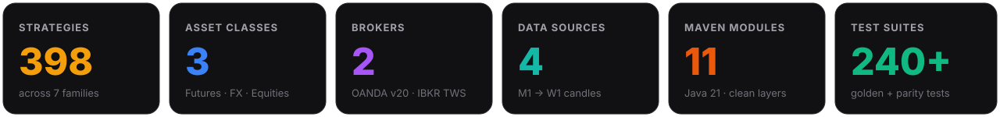
</p>

## ⚡ Why Trading Bridge?

Most retail trading tools force a painful choice: write fast research scripts that **drift from live broker behavior**, or wrestle with rigid legacy platforms that **can't scale across asset classes or AI workflows**.

**Trading Bridge** closes the gap. Built on **Java 21**, an **Electron + Vue 3 Desktop Studio**, and a **unified Control Plane API + LLM CLI (`./tb`)**, it runs the **exact same strategy code** across historical backtests, Walk-Forward validation, evolutionary genetic generation, paper trading, and live execution on **OANDA v20** and **Interactive Brokers (IBKR)**.

<p align="center">
  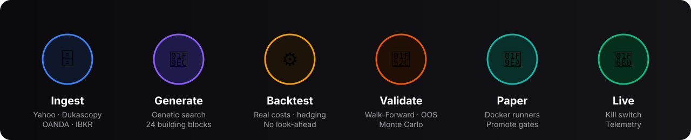 Generate -> Backtest -> Validate -> Paper -> Live" width="100%" />
</p>

| Pillar | What You Get Out of the Box |
| :--- | :--- |
| 🧬 **Evolutionary Strategy Generator** | Native SQX-style genetic strategy studio with **24 indicator & price-action building blocks**, alternating multi-fold **In-Sample / Out-of-Sample bands**, live equity + drawdown % inspector, and 1-click Java codegen. |
| 🏛️ **True Backtest ↔ Live Parity** | Architectural look-ahead prevention, realistic bar-open/intrabar fills, full **OANDA hedging (`REDUCE_ONLY` / `.asCloseOnly()`)**, and CME Futures tick/multiplier & rollover modeling. |
| 🔬 **PhD-Grade Validation** | Multi-fold **Walk-Forward Analysis (WFA)** with Walk-Forward Efficiency (WFE), Parameter Stability & Drift Matrices, **1,000-run Block-Bootstrap Monte Carlo**, and Pareto frontiers. |
| 🗄️ **Multi-Asset Data Hub** | Ingest, inspect, and sync **M1 to W1** bars from **Yahoo Finance / Stooq**, **Dukascopy**, **OANDA v20**, and **IBKR TWS** across Forex Majors, CME Micro/Mini Futures (`MGC`, `GC`, `MES`, `MNQ`, `M2K`, `EMD`), and US Equities. |
| 🛰️ **Prop-Shop Trading Desk** | Real-time telemetry, portfolio margin utilization bars, heartbeat monitoring, drawdown circuit breakers, crash recovery, and an instant **Kill Switch** per runner. |
| 🤖 **3 First-Class Interfaces** | Native **Desktop Studio** (Electron/Vue), interactive **Terminal TUI** (JLine3), and **scriptable CLI (`./tb`)** built for both human quants and autonomous AI agents. |

---

## 📸 Product Tour & Screenshots

### 1. Evolutionary Strategy Generator Studio 🧬
Mine multi-asset strategies automatically using **Genetic Evolution (GA)** or **Monte-Carlo Mining** across **24 institutional signal & regime building blocks**. Partition data with alternating **3× or 4× In-Sample / Out-of-Sample bands**, enforce strict acceptance gates (`IS-Train → IS-Val Cross-Fold → Blind OOS Gate → 80-Run MC`), and inspect every candidate's DNA and generated Java 21 source code in real time.

<p align="center">
  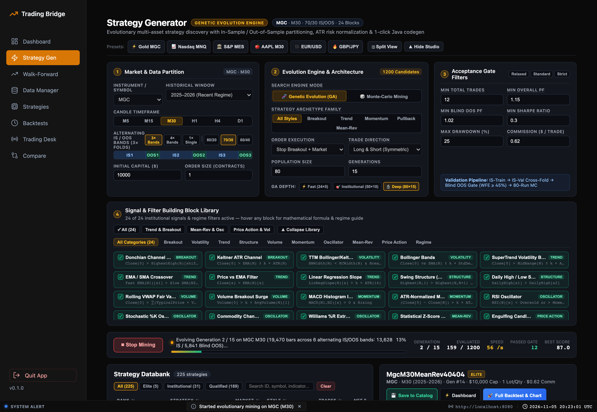
</p>

<p align="center">
  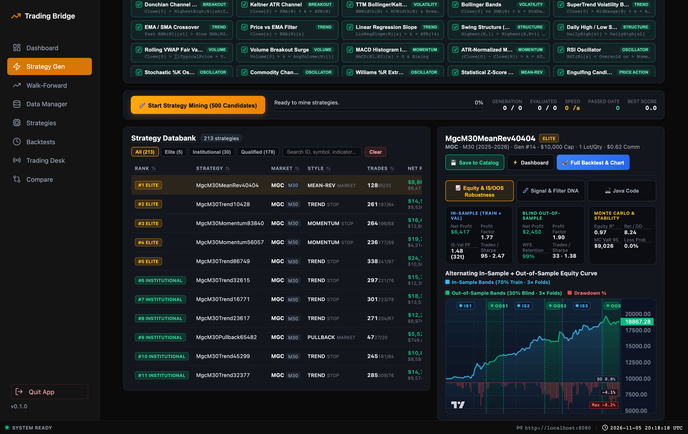
</p>

<table>
  <tr>
    <td width="50%">
      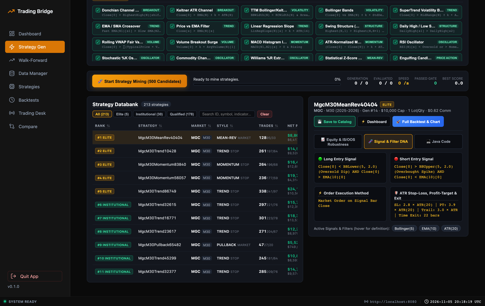
      <p align="center"><sub><strong>Signal &amp; Filter DNA</strong> — Exact entry formulas, order execution &amp; ATR SL/TP/Trail rules</sub></p>
    </td>
    <td width="50%">
      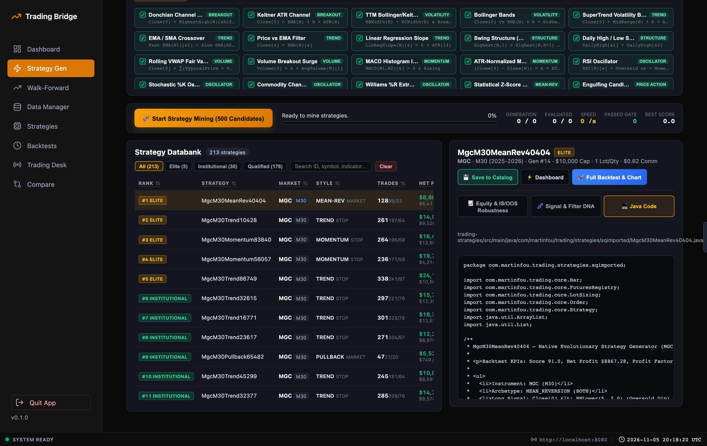
      <p align="center"><sub><strong>1-Click Java 21 Codegen</strong> — Generates clean, zero-dependency <code>Strategy</code> classes</sub></p>
    </td>
  </tr>
</table>

---

### 2. Deep Backtest Analytics, Interactive Trade Chart & Monte Carlo 📈
Inspect every run with TradingView Lightweight Charts—featuring **dual-axis Equity & Drawdown % curves**, **interactive candlestick charts with Buy/Sell/Exit markers and live SL/TP price lines**, **100-path Monte Carlo distribution**, and **side-by-side multi-strategy comparison**.

<p align="center">
  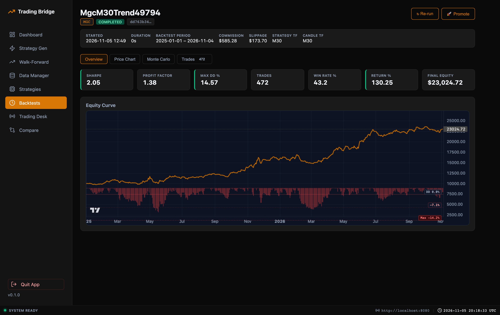
</p>

<table>
  <tr>
    <td width="50%">
      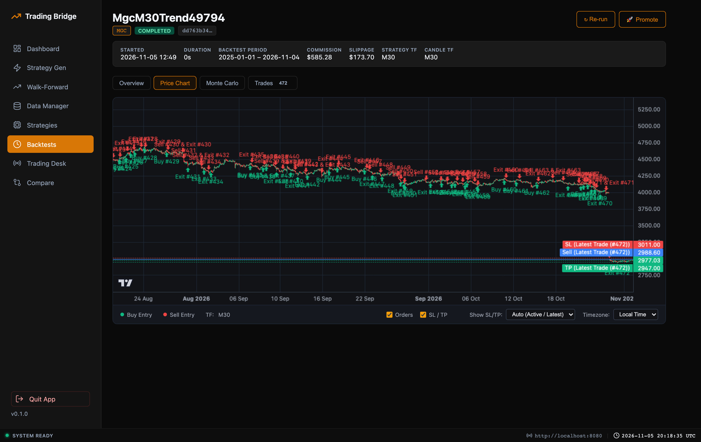
      <p align="center"><sub><strong>Interactive Price &amp; Trade Chart</strong> — Candlesticks, order markers &amp; active SL/TP levels</sub></p>
    </td>
    <td width="50%">
      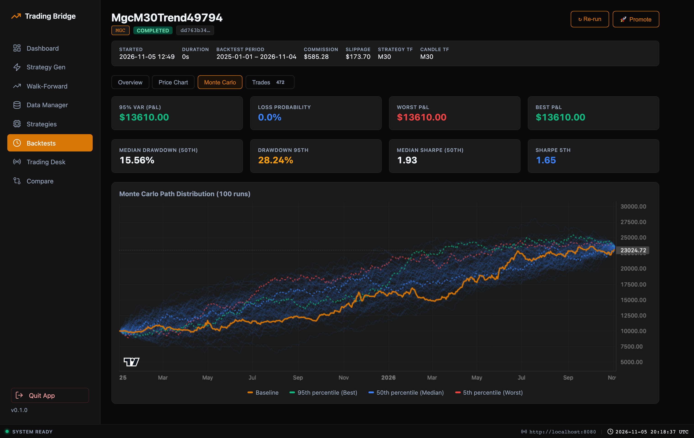
      <p align="center"><sub><strong>Monte Carlo Path Distribution</strong> — 95% VaR, Loss Probability &amp; 5th/50th/95th percentile fan</sub></p>
    </td>
  </tr>
  <tr>
    <td width="50%">
      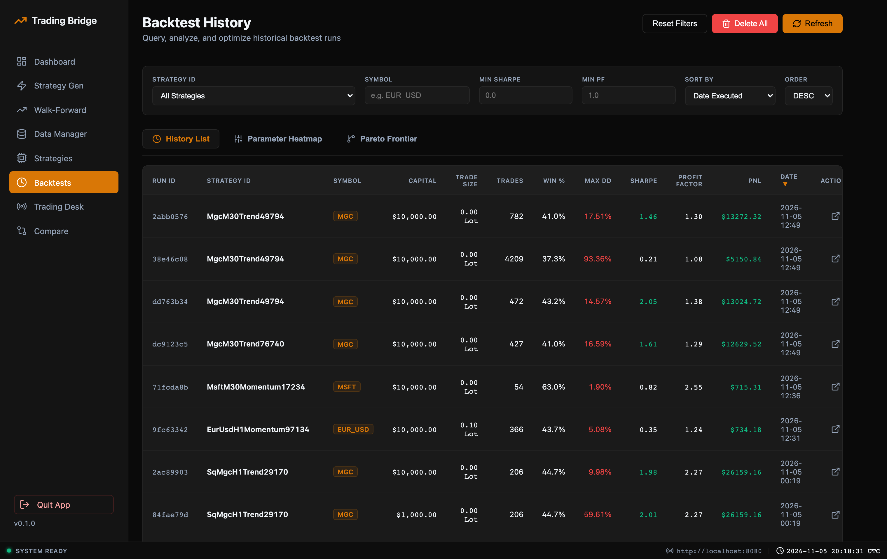
      <p align="center"><sub><strong>Backtest History Archive</strong> — Filter 700+ runs by symbol, Sharpe &amp; Profit Factor</sub></p>
    </td>
    <td width="50%">
      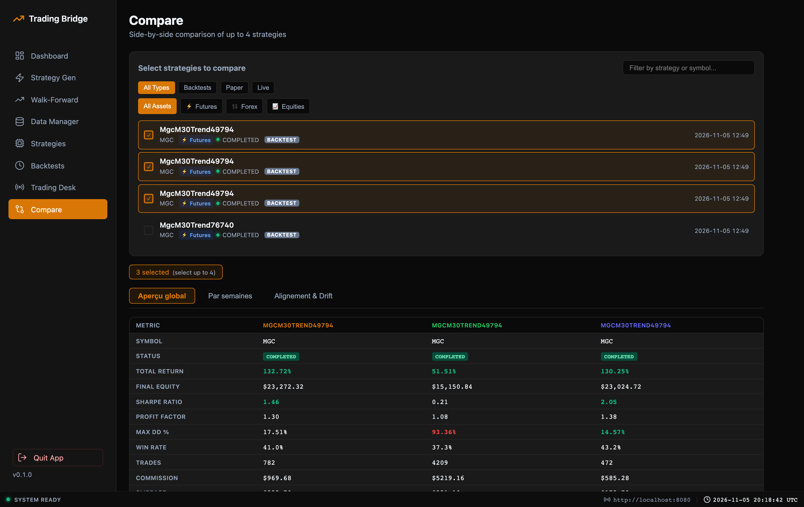
      <p align="center"><sub><strong>Side-by-Side Compare</strong> — Compare up to 4 strategies across return, DD &amp; drift</sub></p>
    </td>
  </tr>
</table>

---

### 3. Command Center & Tiered Institutional Cost Presets ⚡
Configure multi-asset simulations in seconds. Switch seamlessly between **CME Micro/Mini Futures** (`MGC`, `MES`, `MNQ`, `M2K`), **Forex Majors**, and **US Equities** with realistic exchange/ECN commissions and slippage automatically applied per instrument.

<p align="center">
  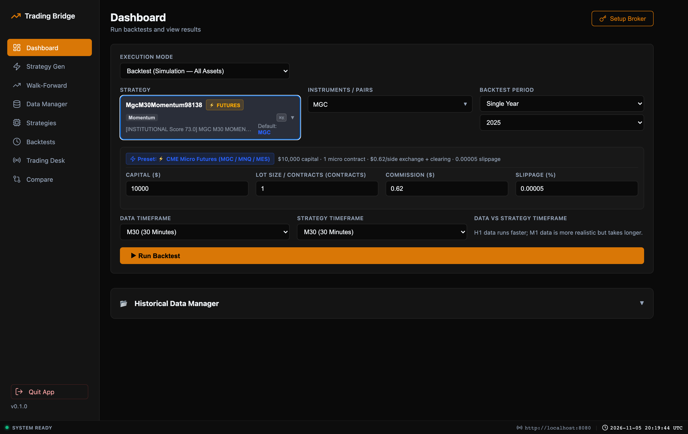
</p>

<table>
  <tr>
    <td width="50%">
      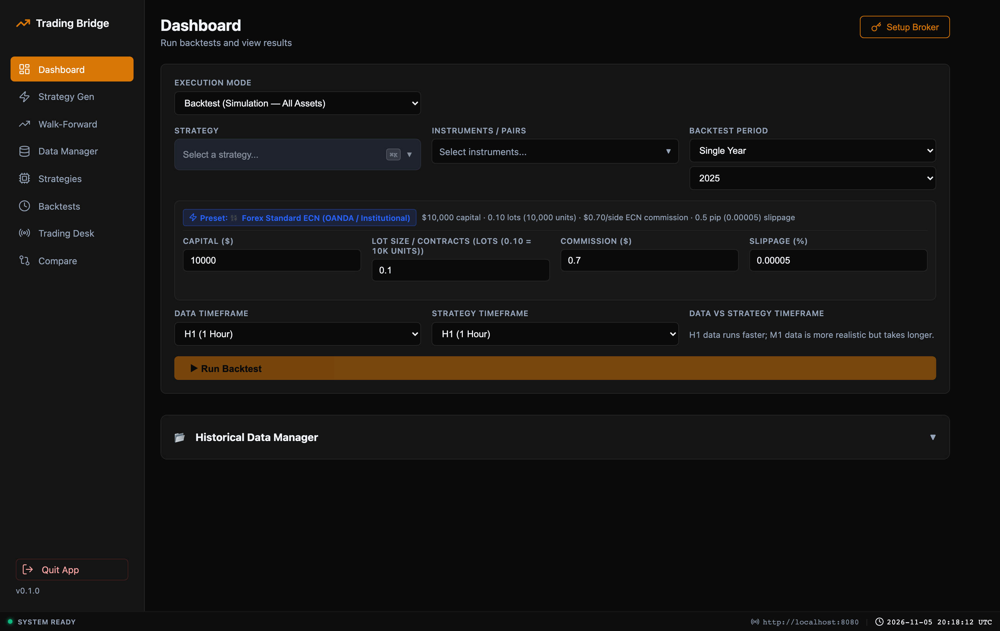
      <p align="center"><sub><strong>Simulation Launchpad</strong> — Multi-timeframe (M1–W1) &amp; period controls</sub></p>
    </td>
    <td width="50%">
      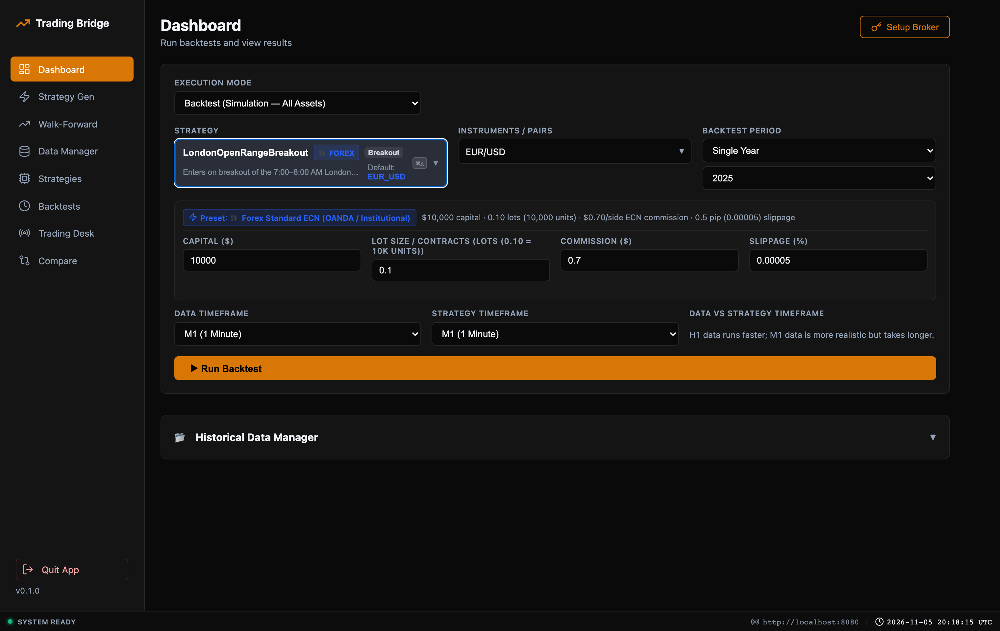
      <p align="center"><sub><strong>Forex ECN Presets</strong> — OANDA Core commission &amp; lot size auto-configuration</sub></p>
    </td>
  </tr>
</table>

---

### 4. Walk-Forward Analysis (WFA) Hub — Overfitting Prevention 🔬
Stop deploying curve-fitted strategies. The **WFA Hub** runs sliding or anchored In-Sample / Out-of-Sample folds, computes **Walk-Forward Efficiency (WFE)**, and audits parameter drift across market regimes before a strategy ever touches paper capital.

<p align="center">
  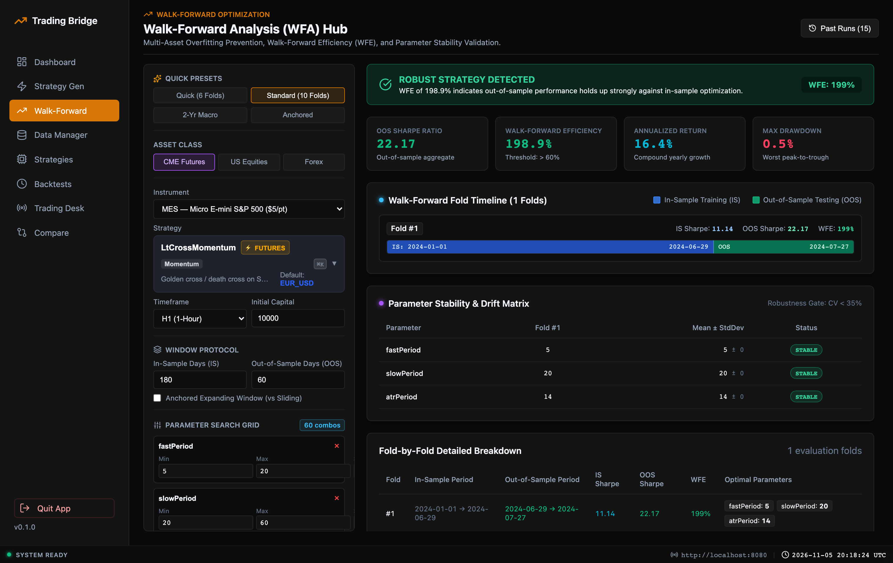
</p>

---

### 5. Prop-Shop Live & Paper Trading Desk 🛰️
Monitor every active container and strategy runner from a single operations board. Track **realized & floating P&L**, **portfolio margin utilization**, **PDT counters**, and **telemetry heartbeats**—with one-click **Inspect** and emergency **Kill** controls.

<p align="center">
  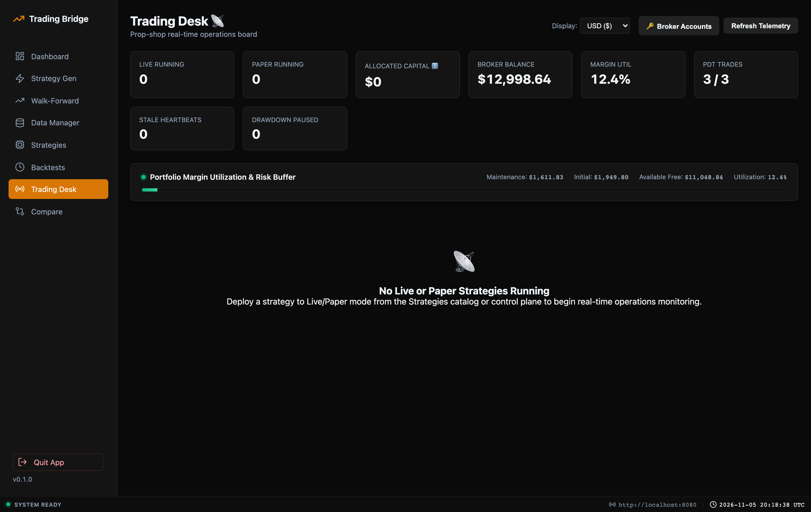
</p>

---

### 6. 398+ Quantitative Strategies Across 7 Families 🗂️
Explore a rich, searchable catalog spanning **StrategyQuant & Generated Models**, **Prop Mechanical**, **Creative**, **Long-Term**, **Weekly News**, and **Harness** families—complete with command-palette filtering (`⌘K`) and one-click promotion.

<table>
  <tr>
    <td width="50%">
      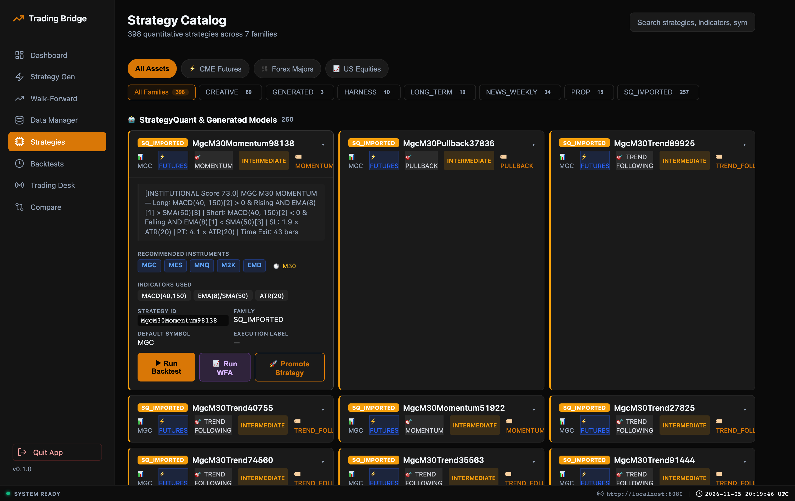
      <p align="center"><sub><strong>Interactive Strategy Cards</strong> — Formulas, recommended instruments &amp; 1-click actions</sub></p>
    </td>
    <td width="50%">
      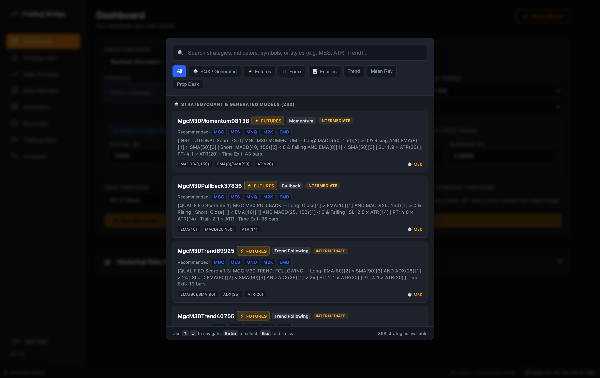
      <p align="center"><sub><strong>Instant Command Palette (⌘K)</strong> — Search 398 strategies by asset class, style, or indicator</sub></p>
    </td>
  </tr>
</table>

---

### 7. Historical Data Management Hub (M1–W1) & Custom Universe Builder 🗄️
Visual 20-year availability matrix (2006–2026) across **Forex Majors**, **CME Micro/Mini Futures** (`EMD`, `GC`, `M2K`, `MES`, `MGC`, `MNQ`), and **US Small/Mid/Large Cap Equities** across **all 8 standard candle sizes (`M1` to `W1`)**.

<p align="center">
  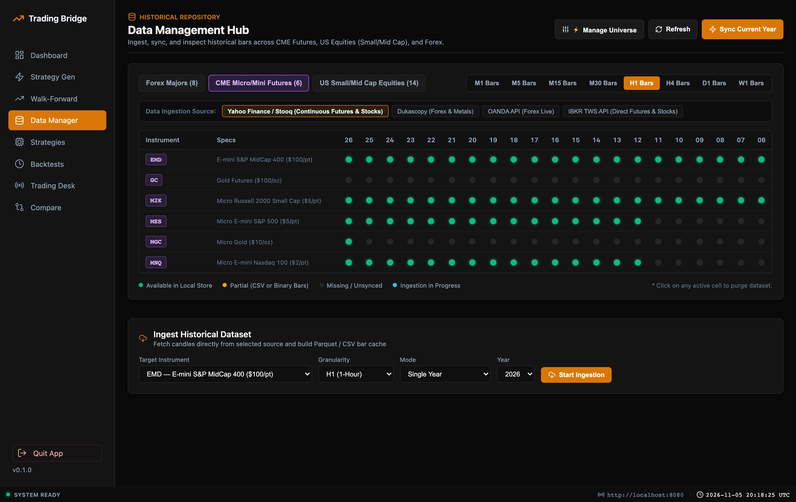
</p>

<table>
  <tr>
    <td width="50%">
      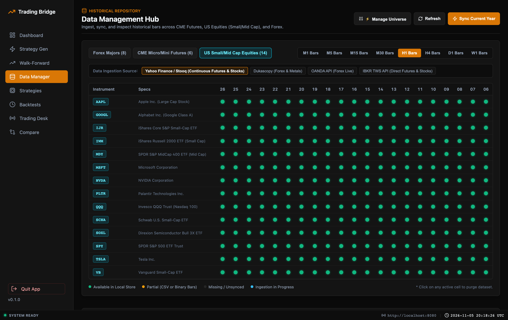
      <p align="center"><sub><strong>20-Year Equities Coverage Matrix</strong> — Green/amber cell inspection &amp; 1-click cache purge</sub></p>
    </td>
    <td width="50%">
      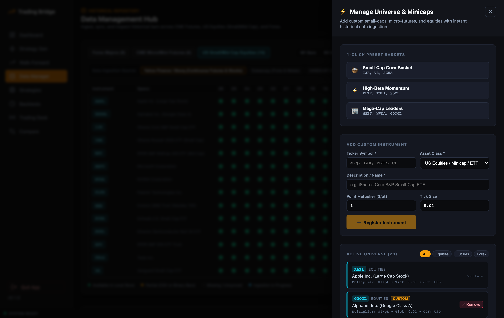
      <p align="center"><sub><strong>Custom Universe &amp; Preset Baskets</strong> — Register any ticker, multiplier &amp; tick size</sub></p>
    </td>
  </tr>
</table>

---

### 8. CLI & Interactive TUI (`./tb`) for Quants & AI Agents 🤖
Prefer the terminal or building automated LLM research loops? `./tb` auto-starts the Control Plane daemon and gives you full parity with the Desktop GUI from any shell.

<p align="center">
  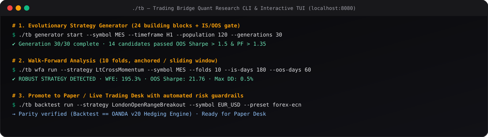
</p>

---

## 🚀 Get Started in 60 Seconds

### Prerequisites
- **JDK 21+** (Eclipse Temurin recommended)
- **Maven 3.9+** (or use the included `./mvnw` wrapper)
- **Node.js 20+** *(optional, for the Electron Desktop Studio)*

### 1. Build the Core Engine & Run a Sample Backtest
```bash
# Clone and build all 11 Java modules
git clone https://github.com/martinfou/trading-bridge.git
cd trading-bridge
./mvnw clean install -DskipTests

# List all 398+ built-in & generated strategies
./mvnw exec:java -pl trading-examples \
  -Dexec.mainClass="com.martinfou.trading.examples.RunBacktest" \
  -Dexec.args="--list"

# Run a sample backtest out of the box
./mvnw exec:java -pl trading-examples \
  -Dexec.mainClass="com.martinfou.trading.examples.RunBacktest" \
  -Dexec.args="--sample"
```

### 2. Launch the Desktop Studio (macOS / Linux / Windows)
```bash
# Starts the Java Control Plane (:8080) + Electron Desktop App automatically
./start-desktop.sh        # macOS / Linux
.\start-desktop.ps1       # Windows PowerShell
```

### 3. Or Drive Everything from the Terminal (`./tb`)
```bash
./tb                      # Launch interactive JLine3 Terminal UI (TUI)
./tb strategies list      # Browse catalog from the command line
./tb generator status     # Inspect evolutionary generator databank
```

### 4. Deploy Paper Trading Runners via Docker
```bash
# Configure OANDA_API_KEY and OANDA_ACCOUNT_ID in .env
docker compose build trader && docker compose up -d trader
```

---

## 🧬 Write a Strategy in 30 Lines of Java

Trading Bridge is designed to be **a joy to extend**. Everything revolves around a single, zero-boilerplate [`Strategy`](trading-core/src/main/java/com/martinfou/trading/core/Strategy.java) interface in `trading-core`:
- **Input:** Completed [`Bar`](trading-core/src/main/java/com/martinfou/trading/core/Bar.java) records (`open`, `high`, `low`, `close`, `volume`, `timestamp`).
- **Output:** Immutable [`Order`](trading-core/src/main/java/com/martinfou/trading/core/Order.java) records with fluent builders (`.withStopLoss()`, `.withTakeProfit()`, `.asCloseOnly()`).
- **Guarantee:** The same class runs unmodified in `BacktestEngine`, Walk-Forward optimization, and live OANDA / IBKR execution.

```java
package com.martinfou.trading.strategies.custom;

import com.martinfou.trading.core.*;
import java.util.*;

public class MyBreakoutStrategy implements Strategy {
    private final String symbol = "EUR_USD";
    private final List<Bar> history = new ArrayList<>();
    private final List<Order> pending = new ArrayList<>();
    private boolean inTrade = false;

    @Override
    public String name() { return "MyBreakoutStrategy"; }

    @Override
    public void onBar(Bar bar) {
        if (history.size() >= 20) {
            double highestHigh = history.subList(history.size() - 20, history.size())
                    .stream().mapToDouble(Bar::high).max().orElseThrow();
            double lowestLow = history.subList(history.size() - 10, history.size())
                    .stream().mapToDouble(Bar::low).min().orElseThrow();

            // Entry: 20-bar channel breakout with chained SL & TP
            if (!inTrade && bar.close() > highestHigh) {
                pending.add(new Order(symbol, Order.Side.BUY, Order.Type.MARKET, 10_000, bar.close())
                        .withStopLoss(lowestLow)
                        .withTakeProfit(bar.close() + 2.0 * (bar.close() - lowestLow)));
                inTrade = true;
            }
            // Exit: always chain .asCloseOnly() for OANDA REDUCE_ONLY parity
            else if (inTrade && bar.close() < lowestLow) {
                pending.add(new Order(symbol, Order.Side.SELL, Order.Type.MARKET, 10_000, bar.close())
                        .asCloseOnly());
                inTrade = false;
            }
        }
        history.add(bar); // Append after signal evaluation to prevent look-ahead bias
    }

    @Override public void onTick(double bid, double ask, long volume) {}
    @Override public List<Order> getPendingOrders() {
        List<Order> out = new ArrayList<>(pending);
        pending.clear();
        return out;
    }
    @Override public void reset() { history.clear(); pending.clear(); inTrade = false; }
}
```

> [!TIP]
> **Always chain `.asCloseOnly()` on exit orders!** Trading Bridge models full OANDA `hedgingEnabled=true` semantics: an opposite-side order without `.asCloseOnly()` opens an independent hedge position, whereas `.asCloseOnly()` issues a `REDUCE_ONLY` close.

---

## 🏗️ Modular Architecture

Trading Bridge is structured as a clean, layered **11-module Maven monorepo** paired with an **Electron + Vue 3 Desktop app** and a **Laravel Mission Control dashboard**:

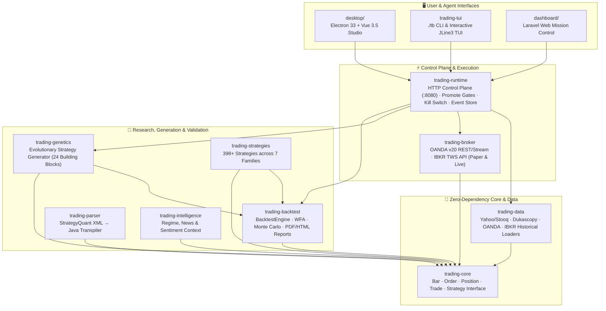

| Module | Responsibility |
| :--- | :--- |
| [`trading-core`](trading-core) | Pure domain models (`Bar`, `Order`, `Position`, `Trade`, `Strategy`) with **zero internal dependencies**. |
| [`trading-backtest`](trading-backtest) | Deterministic `BacktestEngine`, hedging & CME futures realism, Walk-Forward Analysis, Monte Carlo, and offline HTML/PDF report exporters. |
| [`trading-data`](trading-data) | Multi-source historical ingestion (`Yahoo`, `Dukascopy`, `OANDA`, `IBKR`), session-aware timeframe aggregation (`M1`→`W1`), and symbol mapping. |
| [`trading-strategies`](trading-strategies) | **398+ strategies** organized into `prop`, `creative`, `generated`, `longterm`, `news`, `harness`, and `sqimported` packages. |
| [`trading-genetics`](trading-genetics) | Evolutionary strategy generator with 24 indicator building blocks, alternating IS/OOS validation gates, and clone deduplication. |
| [`trading-broker`](trading-broker) | Live & paper execution adapters for **OANDA v20** and **Interactive Brokers (IBKR TWS)** with crash recovery. |
| [`trading-runtime`](trading-runtime) | HTTP Control Plane server (`:8080`), strategy promotion gates, JSONL event store, and live runner orchestration. |
| [`trading-tui`](trading-tui) | JLine3 terminal client and `./tb` quant research CLI. |
| [`trading-intelligence`](trading-intelligence) | Macro news playbooks, market regime detection, and sentiment overlays. |
| [`trading-parser`](trading-parser) | StrategyQuant XML to native Java strategy transpiler. |
| [`desktop/`](desktop) | Cross-platform **Electron + Vue 3 + TypeScript** dark-mode quantitative workstation. |

---

## 🧪 Battle-Tested Engineering & Verification

Every change in Trading Bridge is guarded by **240+ automated test suites** verifying fill mechanics, accounting invariants (`totalPnl == sum(trades) - costs`), OANDA hedging edge cases, and golden backtest reproducibility.

```bash
# Run the full test suite across all modules
./mvnw clean test

# Run deterministic BacktestEngine & hedging contract tests
./mvnw test -pl trading-backtest -Dtest="BacktestEngineContractTest,PlatformRobustnessTest"

# Run golden regression backtests
./mvnw test -pl trading-examples -Dtest=GoldenBacktestTest
```

---

## 📚 Documentation Hub

Dive deeper into the architecture, strategy playbooks, and operational runbooks in [`docs/documentation-hub.md`](docs/documentation-hub.md) or browse the interactive showcase at [`docs/index.html`](docs/index.html) ([**martinfou.github.io/trading-bridge**](https://martinfou.github.io/trading-bridge/)):

- 🧭 **Architecture & Specs:** [`docs/architecture.md`](docs/architecture.md) · [`docs/project-overview.md`](docs/project-overview.md) · [`docs/integration-architecture.md`](docs/integration-architecture.md)
- ⚡ **CME Futures & Cost Realism:** [`docs/mes-cme-futures-realism-guide.md`](docs/mes-cme-futures-realism-guide.md) · [`docs/real-cost-model-hourly-spec.md`](docs/real-cost-model-hourly-spec.md)
- 🛡️ **Prop-Shop Operations & Guardrails:** [`docs/prop-shop-runbook.md`](docs/prop-shop-runbook.md) · [`docs/TRADING-GUARDRAILS.md`](docs/TRADING-GUARDRAILS.md) · [`docs/run-promotion-playbook.md`](docs/run-promotion-playbook.md)
- 🧑‍💻 **Developer & Contributor Guides:** [`docs/development-guide.md`](docs/development-guide.md) · [`docs/contributing.md`](docs/contributing.md) · [`docs/testing.md`](docs/testing.md)

---

<p align="center">
  Built with ☕, Java 21, and quantitative rigor by <a href="https://martinfournier.com"><strong>Martin Fournier</strong></a>.
</p>
