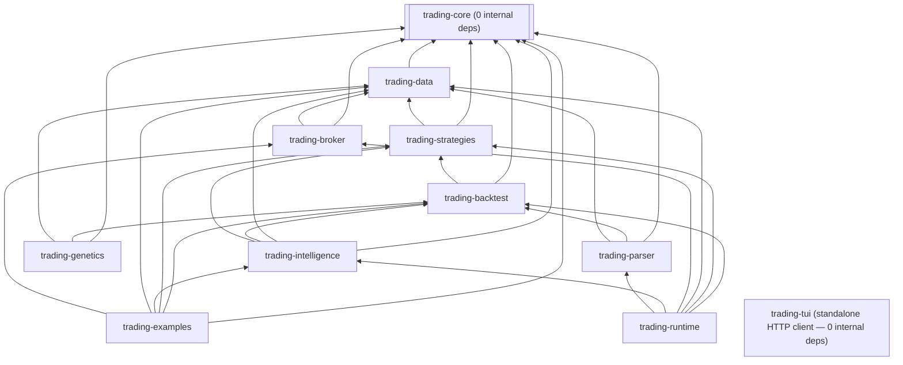

# Project Context for AI Agents — Trading Bridge

*This file contains critical rules, invariants, and architectural facts that AI agents must follow when implementing code, running research, or operating deployments in **Trading Bridge**. Read [`docs/guide-audiences-humains-et-llm.md`](../docs/guide-audiences-humains-et-llm.md) and [`docs/index.md`](../docs/index.md) for the complete documentation index.*

---

## 1. Project Summary & Current State (November 2026)

**Trading Bridge** is a 4-part institutional quantitative trading monorepo:
1. **`trading-bridge-java` (`/`)**: Java 21 / Maven 4 monorepo with **11 modules** (1,374 `.java` files), a Javalin 6.7 Control Plane exposing **70 HTTP/WS endpoints**, and **9 SQLite WAL tables** (`data/runtime/events.db`).
2. **`trading-bridge-desktop` (`/desktop`)**: Native Electron 33 + Vue 3.5 + TypeScript 5.7 + TradingView Lightweight Charts 5 desktop workstation (**9 views**, **15 components**, **6 composables**), including a Native Evolutionary Strategy Generator (`/generator`) and Walk-Forward Studio (`/wfa`).
3. **`trading-bridge-dashboard` (`/dashboard`)**: PHP 8.3 + Laravel 13.8 stateless SSR Control Room (`/control` + emergency Kill Switch). *(Distinct from external `hermes-web` telemetry receiver).*
4. **`trading-bridge-scripts` (`/scripts`, `/docker`, `/config`, `run-*.sh`)**: 91 Python/Bash scripts & 20 root Java harnesses covering StrategyQuant X (`sqcli`) automation (`sqx_ctrl.py`, `extract_sqx_backtest.py`, `sqx_telemetry_pusher.py`, `sqx_auto_pipeline.py`), IBKR/OANDA telemetry daemons (`ibkr_pnl_push.py`, `ibkr_snapshot_push.py`), Simons 35e–65e microstructure research probes, and 3 isolated Docker execution lanes (`trading-futures`, `trading-live`, `trading-dev`).

---

## 2. Technology Stack & 11-Module Maven DAG

| Component | Version / Choice |
| :--- | :--- |
| **Java** | **21** (`maven.compiler.source/target`, Virtual Threads, Records, Pattern Matching) |
| **Build** | Maven 4.x multi-module (`1.0.0-SNAPSHOT`), Checkstyle (`google_checks.xml`), SpotBugs `4.8.6.2` |
| **Control Plane** | **Javalin 6.7.0** (`ControlPlaneServer`, `BacktestController` — 70 HTTP/WS routes on port `8080`) |
| **Persistence** | **SQLite JDBC 3.49.1.0** + **HikariCP 5.1.0** (`PRAGMA journal_mode=WAL; busy_timeout=5000;`) |
| **JSON / YAML** | Jackson `2.17.2` (`jackson-databind`, `jackson-dataformat-yaml`, `jackson-datatype-jsr310`) |
| **AI / Agentic** | LangChain4j `0.33.0` (`langchain4j-open-ai`, `langchain4j-ollama` in `trading-intelligence`) |
| **TA & Math** | Internal `com.martinfou.trading.core.indicators.*` (23+ indicators) + `ta4j-core 0.18` |
| **Brokers** | OANDA v20 REST/Stream + bundled IBKR TWS API (`com.ib.client.*`, Protobuf `4.29.5`) |
| **Desktop UI** | Electron `33.0.0`, Vue `3.5.0`, Vue Router `4.5.0`, Vite `6.0.0`, `lightweight-charts 5.0.0`, Playwright `1.62.1` |
| **Web Dashboard** | PHP `8.3`, Laravel `13.8`, TailwindCSS `4.0.0`, Vite `8.0.0`, PHPUnit `12.5.12` |

### Strict Maven Module Dependency Graph (Never Violate This DAG)

---

## 3. Critical Implementation Rules

### 3.1 Java Language & Architecture Rules
- **Package root:** `com.martinfou.trading.<module>` (e.g., `com.martinfou.trading.core`, `com.martinfou.trading.runtime`).
- **Domain model style:** Plain classes with **fluent accessor methods** (`bar.symbol()`, `bar.close()`), NOT JavaBeans (`getSymbol()`). Enums nested in domain types (`Order.Side`, `Order.Type`, `Order.Status`).
- **Time (Canonical Invariant):** **UTC `java.time.Instant` everywhere internally** (`Bar`, `Order`, `Trade`, `RunEvent`, SQLite ISO-8601 strings with `Z`). Convert to `America/New_York` only for session/rollover rules (`17:00 ET` FX rollover, CME Globex `16:00–17:00 CT` maintenance break) and `America/Toronto` for human display (`TimeConventions`). **Never use `LocalDateTime.now()` in trading logic.**
- **No Lombok, no Spring Framework** anywhere in the repository.
- **Dependencies:** Declare versions in root `pom.xml` `<dependencyManagement>` first; use `${project.version}` for internal module dependencies.

### 3.2 Strategy, Backtest Realism & Risk Guardrail Rules
- **`Strategy` contract (`trading-core`):** Implement `name()`, `onBar(Bar)` (or `onBar(Bar, Position)`), `onTick(bid, ask, volume)`, `getPendingOrders()`, `reset()`.
- **Order queue draining:** `getPendingOrders()` **must return a copy and clear the internal queue** (use `StrategyOrderQueues.drainPending()` in `trading-strategies`).
- **Shared Indicators:** Use `com.martinfou.trading.core.indicators.*` — do not duplicate SMA, EMA, RSI, ATR, Bollinger, Supertrend, etc. inside strategies.
- **Mandatory Realistic Costs (`docs/TRADING-GUARDRAILS.md`):**
  - Zero-cost backtests are forbidden for strategy evaluation.
  - Use **`RealCostModel`** (`trading-backtest`) for empirical `America/New_York` hour-of-day spread multipliers (where the `16:00–17:59 ET` rollover window widens spreads `3.5x–6.0x`) and ATR spike multipliers.
  - Use **`SwapCalculator`** (`trading-backtest`) for 17:00 NY overnight financing, including **3x triple-swap on Wednesday (FX) / Friday (Equities & Commodities)**, while exempting `AssetClass.FUTURES` (CME Futures have zero broker overnight swap).
  - Never infer intraday fade edges at `16:00–17:00 ET` from BID-only bars (`dBID = dMID - 0.5 * dSpread` artifact proven in study `64e`); verify on `price=BA` or `MID` bars.
- **Pre-Trade Safety Guardrails (`trading-core`):**
  - **`OrderTripwire`:** Blocks quantities/prices `<= 0` or `NaN`, orders `> 50` lots/contracts, notional `> $5M`, duplicate `clientOrderId`, or `> 15` orders within 60 seconds.
  - **`SmallAccountMarginGuard`:** Caps single-position initial margin at **50% of account equity** and enforces FINRA Pattern Day Trader (**PDT**) limits on US equities (`< $25k` equity).
  - **Two-Sided Risk Sizing (`RiskSizing` / `LiveStrategyRunner`):** Always apply the quote-to-home currency conversion factor (`USD -> CAD`, `JPY -> CAD`) and enforce the `5x NAV` max notional cap (`maxNotionalNavMultiple: 5` in `config/live-config.json`).
- **Startup Reconciliation Lock (`ControlPlaneServer`):** Mutating calls (`POST`, `PUT`, `DELETE`) to `/api/runs*` and `/api/strategies*` return **`503 Service Unavailable`** until `runManager.isReconciliationComplete()` is `true`.

### 3.3 Operations, IBKR/OANDA & Deployment Rules
- **Retired script:** `scripts/deploy.sh` is **retired** (exits with code `2`). Always use **`scripts/pre-deploy-gate.sh`** and **`scripts/deploy-paper.sh`** (`--apply` to execute; dry-run by default).
- **Lane Isolation:**
  - `trading-live` (`TB_LANE=paper`, `.env.paper`, OANDA `-004`): Runs the 4 `GBP_JPY` H1 ELITE SQX strategies.
  - `trading-dev` (`TB_LANE=dev`, `.env.dev`, OANDA `-003`, managed via `scripts/dev-lane.sh`): Isolated rehab lane.
  - `trading-futures` (`docker/docker-compose.futures.yml`, IBKR Paper `DUR967322` on `127.0.0.1:4002`): Runs the 3 `MGC` M30 ELITE SQX strategies (`IbkrLiveRunner`).
- **IBKR ClientId & Sentinel Rules:**
  - Strict `clientId` separation on IB Gateway (`:4002`): `11` = `IbkrLiveRunner`, `90` = `ibkr_snapshot_push.py`, `98` = `ibkr_pnl_push.py`.
  - Always stamp `Order.orderRef` with the strategy ID on both entry and exit orders; persist fills in `data/state/futures/ibkr-fills-journal.json`.
  - Filter out IBKR's `Double.MAX_VALUE` (`1.7976931348623157e308`, `abs(v) > 1e300`) sentinel on `CommissionReport.realizedPNL` (emitted on opening fills) and `accountSummary` tags; **never** substitute `0.0` for missing data.

### 3.4 Critical Don't-Miss Anti-Patterns

| Don't | Do Instead |
| :--- | :--- |
| Put broker, HTTP, or SQLite code in `trading-core` | Place in `trading-data`, `trading-broker`, `trading-backtest`, or `trading-runtime` |
| Return `pendingOrders` list without clearing it | Use `StrategyOrderQueues.drainPending()` (copy then clear) |
| Run zero-cost backtests or trust 17:00 ET BID-only fades | Enable `RealCostModel` + `SwapCalculator` and verify on `price=BA` / `MID` bars |
| Mix CME Futures (`1.0` contract) and FX (`0.01` lot) in one run | Enforce `isCompatibleBasket` (`useStrategyCatalog.ts`) and `useCostPresets.ts` |
| Run `scripts/deploy.sh` | Run `./scripts/pre-deploy-gate.sh` then `./scripts/deploy-paper.sh --apply` |
| Emit `0.0` or FX rate `1.0` on missing IBKR/OANDA data | Fail closed (`RuntimeError`) or emit `null`/`None` |
| Commit `.env*`, `broker-accounts.local.json`, or API tokens | Use environment variables / gitignored `.env.paper` & `.env.dev` |
| Write `docs/*.md` in English (unless specified) | Write `docs/*.md` in **French**; keep code identifiers and `project-context.md` in **English** |

---

## 4. Key Paths Reference

| Path | Purpose |
| :--- | :--- |
| `docs/index.md` | Master documentation index (by Audience & by Part) |
| `docs/guide-audiences-humains-et-llm.md` | Role-based onboarding for 4 Human personas & 3 LLM agent types |
| `docs/TRADING-GUARDRAILS.md` | 8 non-negotiable quantitative & operational guardrails |
| `docs/api-contracts-trading-bridge-java.md` | Catalog of all 70 HTTP REST & WebSocket endpoints in `trading-runtime` |
| `docs/data-models-trading-bridge-java.md` | Schema of all 9 SQLite WAL tables (`events.db`) |
| `trading-core/.../core/` | `Bar`, `Order`, `Trade`, `Position`, `Strategy`, calendars, `OrderTripwire`, `SmallAccountMarginGuard` |
| `trading-backtest/.../backtest/` | `BacktestEngine`, `RealCostModel`, `SwapCalculator`, `WalkForwardEngine`, `MonteCarloSimulator` |
| `trading-runtime/.../runtime/` | `ControlPlaneServer`, `RunManager`, `IbkrLiveRunner`, `StrategyGeneratorService`, `WfaManager`, `DriftEngine` |
| `desktop/src/` | Electron/Vue 3 workstation (`views/`, `components/`, `composables/`) |
| `dashboard/` | Laravel 13 SSR Control Room (`/control`) |
| `scripts/` | `sqx_ctrl.py`, `sqx_telemetry_pusher.py`, `sqx_auto_pipeline.py`, `ibkr_pnl_push.py`, `deploy-paper.sh`, `prune-db.sh` |
| `config/live-config.json` | Active strategy portfolio, risk budgets (`riskPct`), and per-strategy circuit breakers (`maxDrawdownDollar`) |
