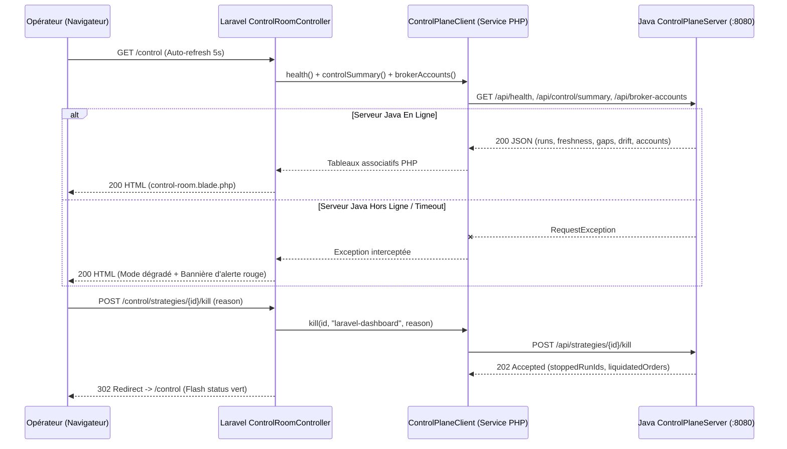

# Architecture Technique — Trading Bridge Dashboard (`trading-bridge-dashboard`)

**Date de mise à jour :** 2026-11-05  
**Framework :** Laravel `13.8` / PHP `8.3`  
**Emplacement racine :** `dashboard/`  
**Patron d'Architecture :** Application Web MVC Server-Side Rendered (SSR) sans état métier (*Stateless Control Proxy*)

---

## 1. Résumé Exécutif

**Trading Bridge Dashboard** (`dashboard/`) est une console Web d'administration légère conçue pour être déployée sur un serveur VPS ou un poste de supervision. Son rôle est d'offrir aux opérateurs une vue synthétique de l'état de santé du moteur Java (`trading-runtime`), de la fraîcheur des événements, de l'exposition des stratégies actives, des alertes de dérive (*Drift*) et un bouton d'arrêt d'urgence (**Kill Switch**) accessible depuis n'importe quel navigateur Web sans dépendre d'un framework JavaScript lourd côté client.

---

## 2. Pile Technologique

| Catégorie | Technologie | Version | Rôle |
| :--- | :--- | :--- | :--- |
| **Langage** | PHP | `^8.3` | Exécution serveur rapide et typage strict. |
| **Framework Web** | Laravel | `^13.8` | Routage, injection de dépendances, client HTTP résilient et moteur de templates Blade. |
| **Styling & Bundler** | Tailwind CSS + Vite | `^4.0.0` / `^8.0.0` | Mise en page responsive et feuilles de style autonomes. |
| **Base de Données Locale** | SQLite | `3.x` | Stockage technique des sessions HTTP et messages flash uniquement (`database/database.sqlite`). |
| **Tests Automatisés** | PHPUnit | `^12.5.12` | Tests fonctionnels avec simulation HTTP (`Http::fake()`). |

---

## 3. Architecture Fonctionnelle et Flux de Données



---

## 4. Commandes de Développement et de Test

```bash
cd dashboard

# Installation initiale (composer install, .env, key:generate, migrate, npm build)
composer run setup

# Lancement du serveur de développement (php artisan serve + queue + pail + vite)
composer run dev

# Exécution de la suite de tests PHPUnit (ControlRoomTest)
composer test
```
