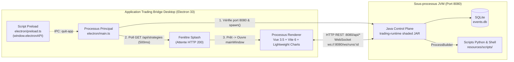

# Architecture — Trading Bridge Desktop (`trading-bridge-desktop`)

**Date de mise à jour :** 2026-11-05  
**Type de composant :** Application de bureau native (`desktop`)  
**Emplacement racine :** `desktop/`  
**Patron d'architecture :** Client MVVM (Vue 3 Composition API) + Processus Principal Electron (JVM Spawner)

---

## 1. Résumé Exécutif

**Trading Bridge Desktop** est le poste de travail graphique principal de la plateforme Trading Bridge. Conçue pour les chercheurs quantitatifs (Quants), les opérateurs de desk et les développeurs de stratégies, l'application permet de :
* **Générer automatiquement des stratégies** via un studio évolutionnaire natif (algorithmes génétiques et recherche Monte-Carlo sur 24 blocs de construction orthogonaux, avec séparation stricte In-Sample / Out-of-Sample aveugle et génération de code Java en 1 clic).
* **Valider la robustesse Walk-Forward (WFA)** sur fenêtres glissantes ou ancrées avec calcul d'efficacité Walk-Forward (WFE) et analyse de stabilité paramétrique.
* **Lancer et analyser des backtests multi-actifs** (Forex OANDA, Contrats à terme CME Micro/Mini tels que `MES`, `MNQ`, `MGC`, et Actions US) avec présélections de coûts institutionnels réalistes.
* **Gérer le catalogue de données historiques** sur 8 unités de temps (`m1` à `w1`) et 4 fournisseurs (`yahoo`, `dukascopy`, `oanda`, `ibkr`).
* **Superviser le trading Paper et Live** (OANDA REST v20 et Interactive Brokers TWS/Gateway) avec conversion multi-devises en temps réel et bouton d'arrêt d'urgence (*Kill Switch*).

---

## 2. Pile Technologique

| Catégorie | Technologie | Version | Rôle & Justification |
| :--- | :--- | :--- | :--- |
| **Shell Applicatif** | Electron | `^33.0.0` | Encapsulation multiplateforme (macOS, Linux, Windows) et gestion du processus JVM enfant. |
| **Packaging** | `electron-builder` | `^25.0.0` | Génération des installateurs `.dmg` (x64/arm64), `.AppImage`/`.deb`/`.pacman` et `.exe` NSIS avec JRE minimal embarqué (`jlink`). |
| **Framework UI** | Vue 3 (Composition API) | `^3.5.0` | Rendu réactif haute fréquence pour les graphiques et flux WebSocket temps réel. |
| **Routage** | Vue Router | `^4.5.0` | Navigation SPA par hash (`createWebHashHistory`) adaptée au protocole `file://` d'Electron. |
| **Bundler & Dev** | Vite + `vite-plugin-electron` | `^6.0.0` / `^0.28.0` | Compilation ultra-rapide TypeScript/Vue et rechargement à chaud (HMR). |
| **Langage** | TypeScript | `^5.7.0` | Typage strict de bout en bout (`src/types/control-plane.ts`) aligné sur les DTOs du serveur Java. |
| **Graphiques Financiers** | TradingView `lightweight-charts` | `^5.0.0` | Rendu Canvas HTML5 haute performance des bougies OHLC, courbes d'équité IS/OOS et simulations Monte-Carlo. |
| **Icônes** | `@lucide/vue` | `^1.17.0` | Système d'icônes vectorielles cohérent avec le thème sombre institutionnel (`#0b0f19` / `#131b2e`). |
| **Tests E2E** | Playwright | `^1.62.1` | Tests de bout en bout automatisés de l'interface. |

---

## 3. Architecture des Processus et Cycle de Vie (`electron/main.ts`)



### 3.1 Résolution des Chemins (`resolveConfig()`)
* **Mode Développement (`VITE_DEV_SERVER_URL` défini)** :
  * Exécutable Java : `$JAVA_HOME/bin/java` (ou `java` dans le `PATH`).
  * Archive JAR : `<repoRoot>/trading-runtime/target/trading-runtime-1.0.0-SNAPSHOT-shaded.jar`.
  * Répertoire de données (`TRADING_BRIDGE_DATA_DIR`) : `<repoRoot>/data/runtime`.
  * Répertoire de ressources (`TRADING_BRIDGE_RESOURCES_DIR`) : `<repoRoot>` (donnant accès direct à `scripts/`).
* **Mode Production Empaqueté** :
  * Exécutable Java : `<process.resourcesPath>/resources/jre/bin/java[.exe]` (JRE minimal généré via `jdeps` + `jlink` par `desktop/scripts/build-jre.sh`).
  * Archive JAR : `<process.resourcesPath>/resources/jar/control-plane.jar`.
  * Scripts embarqués : `<process.resourcesPath>/resources/scripts/` (copiés depuis `../scripts` via `extraResources`).
  * Données utilisateur : `path.join(app.getPath('userData'), 'data')`.

### 3.2 Détection des Conflits sur le Port `8080`
Au démarrage (sauf si `NO_CONTROL_PLANE=1`), `main.ts` vérifie la disponibilité du port TCP `8080` :
1. Si le port est occupé, il interroge `GET http://localhost:8080/api/strategies`.
2. Si une instance existante de Trading Bridge répond, une boîte de dialogue native propose d'arrêter l'ancien processus (`lsof -t -i :8080` + `kill -9` sous macOS/Linux, ou `netstat -ano` + `taskkill /F /PID` sous Windows) ou de quitter.
3. Si un service tiers occupe le port `8080`, une erreur explicite est affichée avant fermeture.

### 3.3 Démarrage & Arrêt Gracieux de la JVM
* **Spawning** : Le serveur Java est lancé avec `--enable-native-access=ALL-UNNAMED` et les variables d'environnement `CONTROL_PLANE_PORT=8080`, `TRADING_BRIDGE_DATA_DIR`, `TRADING_BRIDGE_RESOURCES_DIR` et `DISABLE_STDIN_WATCHER=true`.
* **Splash Screen** : Une fenêtre d'attente sans bordure (`600x400`) s'affiche pendant le polling de `GET /api/strategies` toutes les `500 ms` (timeout `30 s`), puis cède la place à la fenêtre principale (`1400x1000`, min `1024x800`).
* **Extinction (`will-quit`)** : Envoie `SIGTERM` au processus Java avec un délai de grâce de `5 000 ms` avant d'émettre un `SIGKILL` forcé.

---

## 4. Architecture Front-End (Vue 3 & Composables)

### 4.1 Système de Navigation (`src/main.ts` — 10 Routes)
| Route | Nom | Vue (`src/views/`) | Rôle Fonctionnel |
| :--- | :--- | :--- | :--- |
| `/` | — | Redirection vers `/dashboard` | Point d'entrée par défaut. |
| `/dashboard` | `dashboard` | `DashboardView.vue` | Lancement rapide de backtests/runs, suivi en temps réel et matrice rapide de données. |
| `/generator` | `generator` | `StrategyGeneratorView.vue` | Studio évolutionnaire natif (Génétique & Monte-Carlo, 24 blocs, split IS/OOS, promotion Java). |
| `/wfa` | `wfa` | `WfaView.vue` | Studio d'analyse Walk-Forward (fenêtres glissantes/ancrées, verdict de robustesse WFE, dérive des paramètres). |
| `/data-manager` | `data-manager` | `DataManagerView.vue` | Gestionnaire multi-actifs de données historiques (`m1`..`w1`, 4 fournisseurs) et tiroir d'univers (`UniverseManagerDrawer`). |
| `/strategies` | `strategies` | `StrategiesView.vue` | Catalogue filtrable par classe d'actifs, famille et style de trading. |
| `/results` | `results` | `BacktestHistoryView.vue` | Historique SQLite des backtests, Heatmap de sensibilité 2D et Frontière de Pareto. |
| `/results/:runId` | `results-details` | `ResultsView.vue` | Inspection détaillée d'un run (KPIs, Graphique OHLC + indicateurs, Monte-Carlo 100 trajectoires, journal des trades). |
| `/live-trading` | `live-trading` | `LiveTradingView.vue` | Desk d'exécution Paper & Live (OANDA + IBKR), jauge de marge, carnet d'ordres sentiment et Kill Switch. |
| `/compare` | `compare` | `CompareView.vue` | Comparaison multi-runs (jusqu'à 4), statistiques hebdomadaires et audit d'alignement/dérive Live vs Backtest. |

### 4.2 Gestion d'État et Composables (`src/composables/`)
* **`useControlPlane.ts`** : Client HTTP REST typé centralisant tous les appels vers `http://localhost:8080/api/*` (runs, générateur, WFA, stratégies, portes de promotion, comptes courtiers, données historiques, instruments, backtests SQLite) et routant automatiquement les erreurs vers la barre d'état.
* **`useRunWebSocket.ts`** : Client WebSocket (`ws://localhost:8080/ws/runs/:runId`) recevant les événements temps réel (`BAR`, `ORDER_FILLED`, `POSITION_OPENED`, `RUN_COMPLETED`, etc.) avec reconnexion automatique après `2 000 ms`.
* **`useCostPresets.ts`** : Catalogue de 6 profils de coûts et de taille de position réalistes par classe d'actifs :
  * `CME_MICRO_FUTURES` (`1` contrat, `0,62 $`/côté, `1,0` tick de slippage)
  * `CME_FULL_FUTURES` (`1` contrat, `2,10 $`/côté, `1,0` tick de slippage)
  * `IBKR_FUTURES_TIERED` (`1` contrat, `0,85 $`/côté, `1,0` tick de slippage)
  * `OANDA_FOREX_CORE` (`0,10` lot / 10k unités, `0,70 $`/côté, `0,2` pip de slippage)
  * `OANDA_SPOT_GOLD` (`0,10` lot, `1,50 $`/côté, `0,5` pip de slippage)
  * `IBKR_EQUITY_TIERED` (`10` actions, `1,00 $`/ordre, `0,01 $` de slippage)
* **`useStrategyCatalog.ts`** : Gestionnaire de catalogue persistant les filtres dans `localStorage` (`trading_bridge_strategy_filters`), classifiant automatiquement les stratégies en 5 groupes métiers et appliquant le garde-fou d'isolation de panier (**`isCompatibleBasket`**) qui interdit de mélanger des contrats à terme entiers (`1.0` contrat CME) avec des lots fractionnaires Forex (`0.01` lot) dans un même run.
* **`useStatusBar.ts` & `controlPlaneConfig.ts`** : Singleton de notifications globales (auto-effacement après 6 secondes pour les messages non-bloquants) et configuration réactive de l'URL du Control Plane.

---

## 5. Visualisation Financière Avancée (`lightweight-charts`)

L'application exploite trois moteurs graphiques spécialisés :
1. **`TradeChart.vue`** :
   * Superpose les bougies OHLC (`CandlestickSeries`), les indicateurs techniques (`SMA`, `EMA`, `Bandes de Bollinger` sur l'échelle principale ; `RSI` et `ATR` sur échelles dédiées), les marqueurs d'exécution (`createSeriesMarkers`) et les lignes de prix d'entrée/SL/TP/Bid/Ask.
   * Adapte dynamiquement la précision décimale (`2` décimales pour Futures/Or, `3` pour paires JPY, `5` pour Forex majeur).
   * Nettoie et déduplique les horodatages lors des rollovers de contrats à terme (`getCleanBars`) et charge l'historique à la demande par défilement arrière (`loadMoreBars` par blocs de 5 000 bougies).
2. **`EquityChart.vue`** :
   * Supporte l'affichage hybride **In-Sample / Out-of-Sample (`oosSplitIndex` / `oosSplitRatio`)** via deux séries `AreaSeries` distinctes (bleu ciel pour l'échantillon d'apprentissage IS, vert émeraude pour la validation aveugle OOS) accompagnées d'une ligne de séparation verticale et d'un bandeau HTML synchronisé, ainsi qu'un histogramme de Drawdown (`HistogramSeries`).
3. **`MonteCarloChart.vue` & `ParetoFrontierChart.vue`** :
   * Superposition de 100 trajectoires d'équité simulées par rééchantillonnage (mettant en évidence les percentiles P5, P50 et P95) et nuage de points SVG interactif traçant l'enveloppe convexe de la frontière de Pareto (`Sharpe` vs `Max Drawdown`).

---

## 6. Commandes de Développement, Build et Tests

```bash
cd desktop

# Installer les dépendances
npm install

# Lancer en mode développement (Vite + Electron + démarrage auto du JAR Control Plane)
npm run electron:dev

# Vérification du typage TypeScript (vue-tsc) et build front-end
npm run build

# Générer un exécutable natif avec JRE embarqué
./scripts/build-jre.sh
npm run package:mac     # ou package:linux / package:win
```
