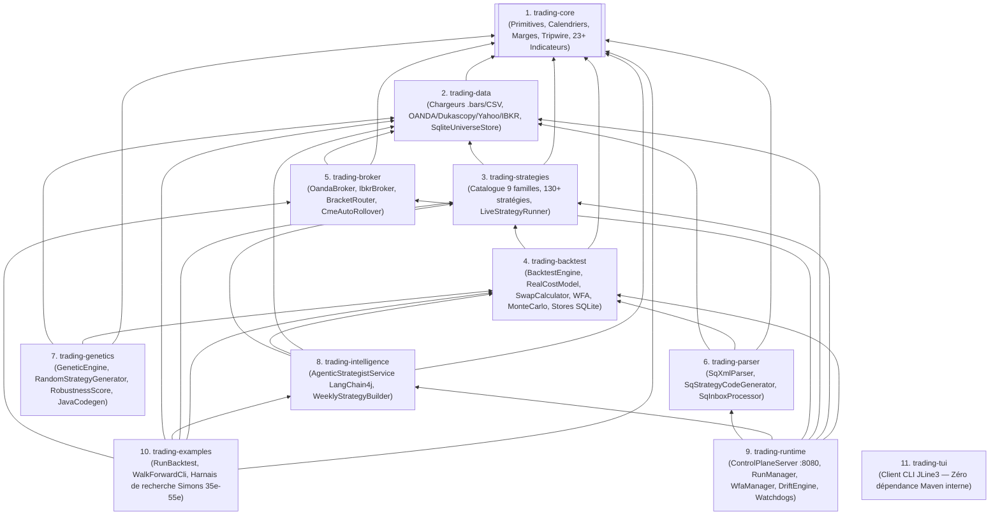

# Architecture Technique — Trading Bridge Java (`trading-bridge-java`)

**Date de mise à jour :** 2026-11-05  
**Langage & Runtime :** Java 21 (Virtual Threads, Records, Pattern Matching)  
**Système de Build :** Maven 4.x (`1.0.0-SNAPSHOT`) — **11 Modules** (1 374 fichiers `.java`)  
**Patron d'Architecture :** Monolithe Modulaire Orienté Événements + Plan de Contrôle API/WebSocket

---

## 1. Résumé Exécutif

**`trading-bridge-java`** constitue le cœur algorithmique, analytique et opérationnel de la plateforme **Trading Bridge**. Il assure :
1. **L'exécution de backtests multi-actifs haute fidélité** (`FOREX`, `FUTURES`, `EQUITY`, `COMMODITIES`) intégrant la modélisation horaire des spreads (`RealCostModel`), le calcul exact des swaps et triples rollovers (`SwapCalculator`), les calendriers Globex/NYSE et la valorisation multi-devises.
2. **La découverte et la validation quantitative de stratégies** via l'importation StrategyQuant X (`trading-parser`), le moteur évolutionnaire natif sur Virtual Threads (`trading-genetics` + `StrategyGeneratorService`), l'analyse Walk-Forward (`WalkForwardEngine` / `WfaManager`) et le rééchantillonnage Monte-Carlo.
3. **Le trading Paper et Live multi-courtiers** sur **OANDA v20** (`OandaBroker`, `LiveStrategyRunner`) et **Interactive Brokers TWS/Gateway** (`IbkrBroker`, `IbkrLiveRunner`, `FuturesTradingEngine`), protégé par des garde-fous pré-trade (`OrderTripwire`, `SmallAccountMarginGuard`), des coupe-circuits par stratégie et un moteur de détection de dérive à 9 dimensions (`DriftEngine`).
4. **Le Plan de Contrôle central (`ControlPlaneServer`)** exposant 70 endpoints HTTP REST et WebSocket, adossé à 9 tables SQLite en mode WAL via HikariCP.

---

## 2. Graphe de Dépendances des 11 Modules Maven (DAG Strict)

Le graphe de dépendances interne est strictement acyclique (`trading-core` à la base, `trading-tui` totalement découplé) :

---

## 3. Responsabilités Détaillées des 11 Modules

| # | Module | Classes Clés & Responsabilités |
| ---: | :--- | :--- |
| **1** | **`trading-core`** | **Socle de domaine pur** : `Bar`, `Order`, `Trade`, `Position`, contrat `Strategy`, `AssetClass`, `InstrumentDefinition`. Valorisation multi-actifs (`AssetValuationRegistry`, `FuturesRegistry` pour `MES`/`MNQ`/`MGC`/`M2K`/`EMD`, `RiskSizing`). Calendriers de marché (`ForexMarketCalendar`, `CmeGlobexMarketCalendar`, `CmeContractExpiryCalculator`, `EquityMarketCalendar`). Garde-fous pré-trade (`OrderTripwire`, `MarginTracker`, `SmallAccountMarginGuard`). Plus de 23 indicateurs techniques partagés (`SMA`, `EMA`, `RSI`, `ATR`, `MACD`, `BollingerBands`, `Supertrend`, `IchimokuCloud`, `VWAP`, `VolumeProfile`, etc.). |
| **2** | **`trading-data`** | **Ingestion, cache binaire et univers** : `HistoricalDataLoader`, `BinaryBarsCache` (`.bars`), `TimeframeAggregator` (`M1` $\rightarrow$ `M5`..`W1`), `HistoricalDataManager`. Connecteurs de téléchargement (`DukascopyFetcher` `.bi5` XZ, `OandaHistoricalFetcher`, `OandaPriceClient`, `YahooFinanceFetcher`, `IbkrHistoricalDataDownloader`). Sentiment et calendrier macro (`OandaSentimentService`, `ForexFactoryCalendarClient`). Référentiel SQLite `SqliteUniverseStore` (table `instruments`). Embarque le client officiel IBKR TWS (`com.ib.client.*`, Protobuf `4.29.5`). |
| **3** | **`trading-strategies`** | **Catalogue unifié & Runner OANDA autonome** : `StrategyCatalog` fédérant 9 familles (`PROP`, `SQ_IMPORTED`, `GENERATED`, `LONG_TERM`, `LLM_WEEKLY`, `NEWS_WEEKLY`, `CREATIVE`, `HARNESS`, `EXAMPLE`). Contient `LiveStrategyRunner`, `OandaExecutor`, `RealizedPnlLedger` (v3 idempotent) et `OperationsSnapshotPusher` (synchronisation bidirectionnelle avec Hermes Web). |
| **4** | **`trading-backtest`** | **Moteur de simulation et validation statistique** : `BacktestEngine`, `RunContext`, `FillMode` (`SAME_BAR_CLOSE`, `NEXT_BAR_OPEN`), `RealCostModel` (multiplicateurs horaires NY et volatilité ATR), `SwapCalculator` (rollover 17h00 NY avec triple swap mercredi FX / vendredi Actions, exemption Futures CME). Validation avancée : `WalkForwardEngine`, `MonteCarloSimulator`, `OverfittingDetector` (Deflated Sharpe), `ParameterSweepEngine` (Virtual Threads), `PortfolioBacktestEngine`. Exporteurs `DueDiligenceHtmlExporter` et `PdfReportGenerator` (OpenPDF). Persistance SQLite : `SqliteBacktestRunStore`, `SqliteTradeStore`, `SqliteTradeAlignmentStore`, `SqliteWfaRunStore`. |
| **5** | **`trading-broker`** | **Connecteurs courtiers temps réel** : Interface `Broker`, `PaperBroker`, `PositionReconciler`. **OANDA v20** (`OandaBroker`, `OandaRestClient`, `OandaStreamClient`). **Interactive Brokers TWS/Gateway** (`IbkrBroker`, `IbkrGatewaySupervisor` avec reconnexion exponentielle codes 1100/1101/1102/504, `IbkrOrderExecutionManager`, `IbkrBracketOrderRouter` OCA parent/SL/TP, `IbkrStateReconciler`, `CmeAutoRolloverManager`). |
| **6** | **`trading-parser`** | **Transpileur & Pont StrategyQuant X** : `SqXmlParser`, `SqInterpretedStrategy`, `SqStrategyCodeGenerator` (génération de classes `.java` depuis XML SQX), `Mt4LogParser`, `PineScriptParser`. Pont d'automatisation : `SqInboxProcessor` (`pending/` $\rightarrow$ `passed/` / `failed/` / `dlq/`), `SqCliRunner`, `SqFitnessFeedbackService`. |
| **7** | **`trading-genetics`** | **Moteur évolutionnaire natif** : `GeneticEngine` (sélection par tournoi, croisement, mutation, élitisme sur Virtual Threads), `RandomStrategyGenerator`, générateurs de règles d'entrée/sortie/filtre sur 24 blocs orthogonaux, `RobustnessScore` (score combiné IS + OOS), et `JavaStrategyCodeGenerator`. |
| **8** | **`trading-intelligence`** | **IA Agentique & Pipeline Hebdomadaire** : `AgenticStrategistService` (boucle ReAct LangChain4j avec `MacroTools`, `SentimentTools`, `SeasonalityTools`, protégée contre le biais de look-ahead par `cutoffTimestamp` et plafonnée par `GuardrailChatModel` à **4 itérations ReAct** et **0,50 USD**). Pipeline en 3 étapes : `WeeklyStrategyPlanService`, `WeeklyCompileService` (`WeeklyAstValidator` + `JavaCompiler`), `WeeklyHotSwapService`. Persistance `ResearchInspirationStore`. |
| **9** | **`trading-runtime`** | **Plan de Contrôle & Orchestration** : `ControlPlaneServer` (Javalin 6.7.0, 70 routes HTTP/WS), `RunManager`, `LiveRunExecutor`, `IbkrLiveRunner` & `FuturesTradingEngine`, `StrategyGeneratorService`, `WfaManager`, `PromoteService` & `PromoteGates`, `KillSwitchService`, `DriftEngine` (9 dimensions dont test de Kolmogorov-Smirnov), `StaleRunWatchdog`. Persistance HikariCP : `SqliteEventStore`, `SqliteRunRecordStore`, `SqliteDeploymentStore`. |
| **10** | **`trading-examples`** | **Exécutables CLI & Harnais de Recherche** : `RunBacktest`, `BatchBacktestRunner`, `WalkForwardCli`, `GeneticOptimizationExample`, ainsi que les 20 harnais d'études quantitatives de la série Simons (`35e` à `55e`). |
| **11** | **`trading-tui`** | **Interface Terminal Interactive** : `TradingTuiMain` (JLine 3.26.3) fournissant 16 commandes slash (`/list`, `/status`, `/backtest`, `/promote`, `/trade`, `/kill`, `/sq`, `/weekly-build`, etc.) via HTTP REST. |

---

## 4. Garde-Fous de Sécurité, Marges et Réalisme Institutionnel

1. **`OrderTripwire` (`trading-core`)** : Coupe-circuit pré-soumission bloquant instantanément tout ordre présentant un prix ou une quantité invalide ($\le 0$ ou `NaN`), une taille $> 50$ lots/contrats, une valeur notionnelle $> 5\text{ M\$}$, un `clientOrderId` dupliqué ou une rafale $> 15$ ordres en 60 secondes.
2. **`SmallAccountMarginGuard` (`trading-core`)** : Refuse toute ouverture de position dont la marge initiale excède **50 % des fonds propres (Equity)** du compte, surveille l'utilisation globale de marge et applique la règle réglementaire américaine **FINRA PDT** ($\le 3$ day trades sur 5 jours ouvrés glissants pour les comptes actions $< 25\,000\text{ \$}$).
3. **Conventions Temporelles (`TimeConventions`)** : Tous les horodatages internes (`Bar`, `Order`, `Trade`, `RunEvent`) utilisent exclusivement `java.time.Instant` en **UTC**. Les conversions en fuseau `America/New_York` (clôture 17h00 ET, maintenance Globex, rollovers) ou `America/Toronto` (affichage) sont explicites et conscientes des changements d'heure (DST).
4. **Qualité & Vérification Statique** : Le POM parent exécute automatiquement `maven-checkstyle-plugin` (`google_checks.xml`) et `spotbugs-maven-plugin` (`4.8.6.2`).
