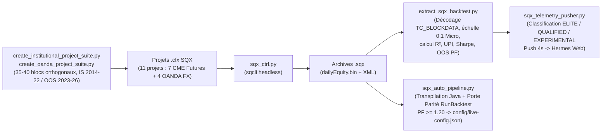

# Architecture Technique — Scripts, Automatisation SQX, Télémétrie & Infrastructure (`trading-bridge-scripts`)

**Date de mise à jour :** 2026-11-05  
**Langages & Outils :** Python 3 (`ibapi`, `urllib`, `sqlite3`, `struct`), Bash, Docker Compose, StrategyQuant X CLI (`sqcli`)  
**Emplacement :** `scripts/` (91 scripts), `docker/`, `config/`, et racine `run-*.sh` (20 harnais)

---

## 1. Résumé Exécutif

La quatrième partie du monorepo (**`trading-bridge-scripts`**) regroupe l'ensemble des pipelines d'automatisation hors-JVM, des démons de télémétrie en production, des sondes de recherche empirique sur la microstructure de marché et de l'orchestration des conteneurs Docker. Elle s'articule autour de **4 sous-systèmes majeurs** :
1. **Usine d'Automatisation StrategyQuant X (SQX)** : Génération programmatique de projets `.cfx`, pilotage CLI (`sqx_ctrl.py`), décodage binaire des archives `.sqx` (`extract_sqx_backtest.py`), diffusion temps réel vers Hermes Web (`sqx_telemetry_pusher.py`) et promotion automatique avec porte de parité Java (`sqx_auto_pipeline.py`).
2. **Démons de Télémétrie Courtiers (IBKR & OANDA)** : Publication horaire des fills réalisés et convertis `USD -> CAD` (`ibkr_pnl_push.py`), photographie toutes les 5 minutes des comptes/positions IBKR (`ibkr_snapshot_push.py`) et vérification de sécurité lecture seule OANDA (`smoke-oanda-readonly.py`).
3. **Laboratoire de Recherche Quantitative & Microstructure (Série Simons 35e–65e)** : Harnais Python et Java d'audit des spreads horaires (`spread-by-hour.py`), des artefacts Bid vs Mid à la clôture de 17h00 ET (`fade-mid-vs-bid.py`), du fixing COMEX de l'or (`gold-settlement-*.py`) et du décompte des rollovers de fin de semaine (`rollover-daycount.py`).
4. **Déploiement Atomique, Supervision Docker & Maintenance SQLite** : Déployeur sans coupure avec réconciliation des positions (`deploy-paper.sh`), porte pré-déploiement (`pre-deploy-gate.sh`), revue de code IA adversariale (`agy-review.sh`), entrypoints Docker à backoff exponentiel et purge quotidienne de base de données (`prune-db.sh`).

---

## 2. Architecture du Pipeline StrategyQuant X (SQX)

### Critères de Classification Institutionnelle (`sqx_telemetry_pusher.py`)
* **Score Composite de Régularité (`0–100`)** : Linéarité $R^2$ (35 pts) + Martin Ratio / $UPI$ (25 pts) + Sharpe Annualisé (15 pts) + Profit Factor OOS (15 pts) + Taille d'échantillon (10 pts).
* **Palier `ELITE` (Déployable)** : $R^2 \ge 0,85$, $UPI \ge 1,20$, $\text{Sharpe} \ge 0,70$, $\text{PF OOS} \ge 1,15$, $\text{Trades} \ge 100$, $\text{MaxDD} \le 20\,\%$, $\text{Profit OOS} > 0$.
* **Palier `QUALIFIED` (Watchlist)** : $R^2 \ge 0,70$, $UPI \ge 0,60$, $\text{PF OOS} \ge 1,05$, $\text{Trades} \ge 50$, $\text{Profit OOS} > 0$.

---

## 3. Architecture des Démons de Télémétrie IBKR (`ibkr_pnl_push.py` & `ibkr_snapshot_push.py`)

| Caractéristique | `scripts/ibkr_pnl_push.py` | `scripts/ibkr_snapshot_push.py` |
| :--- | :--- | :--- |
| **Fréquence & Client ID** | Horaire (systemd) — `clientId = 98` | Toutes les 5 minutes (systemd) — `clientId = 90` |
| **Endpoint Hermes Cible** | `POST /api/trading/pnl-import` (`broker="ibkr"`) | `POST /api/trading/broker/snapshot` |
| **Source de Vérité** | `CommissionReport.realizedPNL` (net de commissions ; ignore la sentinelle `Double.MAX_VALUE` des fills d'ouverture). | `accountSummary` (`NetLiquidation`, `UnrealizedPnL`, `MaintMarginReq`, `AvailableFunds`, `Cushion`) + `positions`. |
| **Déduplication & Attribution** | Regroupe les révisions d'`execId` (`.01`, `.02`) sur `base_exec_id` ; extrait le nom de stratégie depuis `Execution.orderRef` (isole les UUID non attribués dans `leak[]`). | N'émet **jamais** `0` pour une valeur manquante ou sentinelle (`1.797e308` $\rightarrow$ `None`) ; publie `connected: false` en cas de panne de Gateway. |
| **Conversion Devise & Fuseau** | Convertit `USD -> CAD` via les clôtures H1 OANDA `USD_CAD` (lookback 72h, *fail-closed*). Fuseau d'exécution `HERMES_IBKR_EXEC_TZ=UTC`. | Conserve la devise native de chaque contrat et du compte. |

---

## 4. Infrastructure Docker Multi-Couloirs & Déploiement Sécurisé

| Couloir (Lane) | Fichier Compose | Conteneur | Compte Courtier | Stratégies Actives (Nov 2026) |
| :--- | :--- | :--- | :--- | :--- |
| **1. IBKR CME Futures Paper** | `docker/docker-compose.futures.yml` | `trading-futures` | IBKR Paper `DUR967322` (`:4002`, `clientId=11`) | **3 stratégies `MGC` (Micro Or) M30 ELITE** : `sq-mgc-m30-breakout-0-24542`, `sq-mgc-m30-breakout-1-29-102`, `sq-mgc-m30-breakout-0-32921`. |
| **2. OANDA FX Paper** | `docker-compose.yml` | `trading-live` (`TB_LANE=paper`) | OANDA Practice `-004` (`.env.paper`) | **4 stratégies `GBP_JPY` H1 ELITE** : `sq-gbpjpy-h1-breakout-4-5-173`, `3-39-125`, `4-19-179`, `2-20-102` (`riskPct: 0.2%`). |
| **3. OANDA FX Dev/Rehab** | `docker-compose.yml` / `docker-compose.dev.yml` | `trading-dev` (`TB_LANE=dev`) | OANDA Practice `-003` (`.env.dev`) | **5 stratégies en observation** : `vwpreversion`, `consecbar`, `ltrsi3`, `compmomentum`, `monthweekphase`. |

### Séquence de Déploiement Atomique (`scripts/deploy-paper.sh`)
1. **Mode Dry-Run par défaut** : Nécessite explicitement `--apply` pour modifier l'état.
2. **Verrouillage concurrent (`flock`)** : Empêche deux déploiements simultanés (`/tmp/trading-bridge-deploy-$(id -u).lock`).
3. **Porte Pré-Déploiement (`scripts/pre-deploy-gate.sh`)** :
   * Étape 1 : Tests unitaires Maven (`./mvnw -B -DskipITs test`).
   * Étape 2 : Validation syntaxique Docker Compose (`docker compose config --quiet`).
   * Étape 3 : Test de fumée lecture seule OANDA (`python3 scripts/smoke-oanda-readonly.py`, vérifiant `api-fxpractice.oanda.com` et `currency == "CAD"`).
4. **Sauvegarde/Restauration d'État & Réconciliation** : Extrait `/tmp/live-strategy-state-*.json` avant recréation du conteneur, les réinjecte sans écraser les fichiers de statut root, démarre le conteneur et vérifie que la somme `activeTrades` de `/tmp/paper-trading-status.json` correspond exactement aux `openTrades` retournés par l'API OANDA v20.

