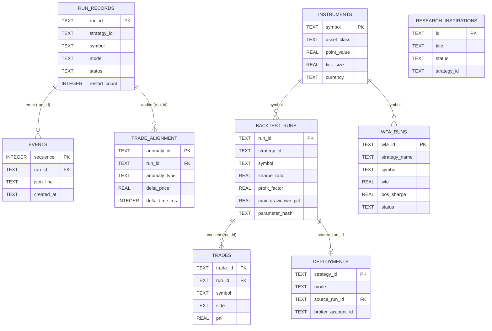

# Modèles de Données & Schémas SQLite — Trading Bridge Java (`trading-bridge-java`)

**Date de mise à jour :** 2026-11-05  
**Moteur de persistance :** SQLite JDBC `3.49.1.0` + Pool de connexions **HikariCP `5.1.0`** (`maximumPoolSize = 10`)  
**Emplacement par défaut :** `data/runtime/events.db` (configurable via `TRADING_BRIDGE_DATA_DIR`)  
**Configuration SQLite :** `PRAGMA journal_mode=WAL;` et `PRAGMA busy_timeout=5000;`

---

## 1. Vue d'Ensemble de l'Architecture de Persistance

La persistance du backend Java s'articule autour de **9 tables SQLite** réparties dans 4 modules Maven (`trading-backtest`, `trading-runtime`, `trading-data`, `trading-intelligence`), complétées par des fichiers d'état JSON atomiques pour la reprise sur panne des exécuteurs autonomes.



---

## 2. Tables du Module `trading-backtest`

### 2.1 Table `backtest_runs` (`SqliteBacktestRunStore`)
Stocke les métriques de synthèse, les paramètres et les courbes d'équité des backtests.

```sql
CREATE TABLE IF NOT EXISTS backtest_runs (
    run_id TEXT PRIMARY KEY,
    strategy_id TEXT NOT NULL,
    symbol TEXT NOT NULL,
    timeframe TEXT,
    start_time TEXT,
    end_time TEXT,
    initial_capital REAL NOT NULL,
    final_capital REAL NOT NULL,
    total_return_pct REAL NOT NULL,
    sharpe_ratio REAL NOT NULL,
    sortino_ratio REAL NOT NULL,
    calmar_ratio REAL NOT NULL,
    max_drawdown_pct REAL NOT NULL,
    win_rate_pct REAL NOT NULL,
    profit_factor REAL NOT NULL,
    total_trades INTEGER NOT NULL,
    winning_trades INTEGER NOT NULL,
    losing_trades INTEGER NOT NULL,
    avg_win REAL NOT NULL,
    avg_loss REAL NOT NULL,
    expectancy REAL NOT NULL,
    sqn REAL NOT NULL,
    parameters_json TEXT,
    parameter_hash TEXT,
    equity_curve_json TEXT,
    trades_json TEXT,
    created_at TEXT NOT NULL
);
CREATE INDEX IF NOT EXISTS idx_backtest_runs_strategy_hash
    ON backtest_runs(strategy_id, parameter_hash);
```
> **Note d'exploitation (`scripts/prune-db.sh`) :** Au-delà de 30 jours (`RETENTION_DAYS=30`), les colonnes volumineuses `equity_curve_json` et `trades_json` sont mises à `NULL` lors de la purge quotidienne à `04:17` tandis que toutes les métriques scalaires (`sharpe_ratio`, `profit_factor`, `max_drawdown_pct`, etc.) sont conservées indéfiniment.

### 2.2 Table `trades` (`SqliteTradeStore`)
Persistance normalisée des transactions individuelles permettant des requêtes analytiques rapides sans désérialiser de blobs JSON.

```sql
CREATE TABLE IF NOT EXISTS trades (
    trade_id TEXT PRIMARY KEY,
    run_id TEXT NOT NULL,
    symbol TEXT NOT NULL,
    side TEXT NOT NULL,
    entry_price REAL NOT NULL,
    exit_price REAL NOT NULL,
    quantity REAL NOT NULL,
    entry_time TEXT NOT NULL,
    exit_time TEXT NOT NULL,
    pnl REAL NOT NULL,
    stop_loss REAL NOT NULL,
    take_profit REAL NOT NULL,
    created_at TEXT NOT NULL
);
CREATE INDEX IF NOT EXISTS idx_trades_run_id_entry_time
    ON trades(run_id, entry_time);
```

### 2.3 Table `trade_alignment` (`SqliteTradeAlignmentStore`)
Stocke les anomalies de réconciliation et de dérive détectées entre un run Live/Paper et un run Backtest sur la même fenêtre temporelle (`TradeRealignmentService`).

```sql
CREATE TABLE IF NOT EXISTS trade_alignment (
    anomaly_id TEXT PRIMARY KEY,
    run_id TEXT NOT NULL,
    anomaly_type TEXT NOT NULL, -- ex: PRICE_SLIPPAGE, MISSING_FILL, ORPHAN_TRADE, TIMING_DRIFT
    order_id TEXT,
    message TEXT NOT NULL,
    delta_price REAL,
    delta_time_ms INTEGER,
    created_at TEXT NOT NULL
);
CREATE INDEX IF NOT EXISTS idx_trade_alignment_run_id
    ON trade_alignment(run_id);
```

### 2.4 Table `wfa_runs` (`SqliteWfaRunStore`)
Stocke l'état et les résultats agrégés des analyses Walk-Forward (`WfaManager` / `WalkForwardEngine`). Les rapports détaillés pli par pli sont enregistrés sur disque dans `reports/wfa/wfa-{wfa_id}.json`.

```sql
CREATE TABLE IF NOT EXISTS wfa_runs (
    wfa_id TEXT PRIMARY KEY,
    strategy_name TEXT NOT NULL,
    symbol TEXT NOT NULL,
    asset_class TEXT,
    timeframe TEXT,
    in_sample_days INTEGER NOT NULL,
    out_of_sample_days INTEGER NOT NULL,
    anchored INTEGER NOT NULL,
    initial_capital REAL NOT NULL,
    wfe REAL,
    oos_sharpe REAL,
    oos_max_drawdown_pct REAL,
    oos_profit_factor REAL,
    oos_return_pct REAL,
    oos_trades_count INTEGER,
    status TEXT NOT NULL,
    created_at TEXT NOT NULL,
    completed_at TEXT,
    error_message TEXT
);
CREATE INDEX IF NOT EXISTS idx_wfa_runs_strategy ON wfa_runs(strategy_name);
CREATE INDEX IF NOT EXISTS idx_wfa_runs_symbol ON wfa_runs(symbol);
CREATE INDEX IF NOT EXISTS idx_wfa_runs_created ON wfa_runs(created_at DESC);
```

---

## 3. Tables du Module `trading-runtime`

### 3.1 Table `run_records` (`SqliteRunRecordStore` — HikariCP)
Enregistre le cycle de vie durable de chaque exécution (`BACKTEST`, `PAPER`, `LIVE`), permettant la reprise après crash au redémarrage du Control Plane et le suivi des redémarrages automatiques par `StaleRunWatchdog`.

```sql
CREATE TABLE IF NOT EXISTS run_records (
    run_id TEXT PRIMARY KEY,
    strategy_id TEXT NOT NULL,
    symbol TEXT NOT NULL,
    mode TEXT NOT NULL,
    config_snapshot TEXT,
    config_hash TEXT,
    status TEXT NOT NULL,
    started_at TEXT NOT NULL,
    completed_at TEXT,
    error_message TEXT,
    ended_payload TEXT,
    last_event_at TEXT,
    restart_count INTEGER DEFAULT 0,
    last_restart_at TEXT
);
```

### 3.2 Table `events` (`SqliteEventStore` — HikariCP)
Journal d'événements en écriture seule (*append-only*) ordonné par numéro de séquence monotone. Alimente la relecture WebSocket (`/ws/runs/{runId}`) et les pistes d'audit (`/api/events/{runId}/audit`).

```sql
CREATE TABLE IF NOT EXISTS events (
    sequence INTEGER PRIMARY KEY AUTOINCREMENT,
    run_id TEXT NOT NULL,
    json_line TEXT NOT NULL,
    created_at TEXT
);
CREATE INDEX IF NOT EXISTS idx_events_run_sequence
    ON events(run_id, sequence);
```

### 3.3 Table `deployments` (`SqliteDeploymentStore`)
Registre de gouvernance des stratégies promues en mode `PAPER` ou `LIVE` via `PromoteService`.

```sql
CREATE TABLE IF NOT EXISTS deployments (
    strategy_id TEXT PRIMARY KEY,
    mode TEXT NOT NULL,
    promoted_at TEXT NOT NULL,
    source_run_id TEXT NOT NULL,
    checks_json TEXT NOT NULL,
    execution_label TEXT,
    broker_account_id TEXT
);
```

---

## 4. Table du Module `trading-data`

### 4.1 Table `instruments` (`SqliteUniverseStore`)
Référentiel multi-actifs des instruments financiers, pré-amorcé automatiquement avec **19 instruments standards** (`FOREX` : `EUR_USD`, `GBP_USD`, `USD_JPY`, `GBP_JPY`, `AUD_USD`, `USD_CAD`, `USD_CHF`, `NZD_USD` ; `FUTURES` : `MES`, `MNQ`, `MGC`, `M2K`, `EMD` ; `EQUITY` : `IJR`, `VB`, `SCHA`, `PLTR`, `TSLA`, `SOXL`) et extensible par l'utilisateur (`is_custom = 1`).

```sql
CREATE TABLE IF NOT EXISTS instruments (
    symbol TEXT PRIMARY KEY,
    name TEXT NOT NULL,
    asset_class TEXT NOT NULL, -- FOREX, FUTURES, EQUITY, COMMODITIES, CRYPTO
    point_value REAL NOT NULL,
    tick_size REAL NOT NULL,
    currency TEXT NOT NULL,
    is_custom INTEGER NOT NULL DEFAULT 0,
    provider_ticker TEXT
);
```

---

## 5. Table du Module `trading-intelligence`

### 5.1 Table `research_inspirations` (`ResearchInspirationStore`)
Stocke les hypothèses de stratégies générées ou soumises au pipeline de recherche assisté par IA.

```sql
CREATE TABLE IF NOT EXISTS research_inspirations (
    id TEXT PRIMARY KEY,
    title TEXT NOT NULL,
    description TEXT NOT NULL,
    status TEXT NOT NULL,
    result_status TEXT,
    strategy_id TEXT,
    metrics_json TEXT,
    created_at TEXT NOT NULL,
    updated_at TEXT NOT NULL
);
```
