# Architecture d'Intégration Inter-Parties — Trading Bridge

**Date de mise à jour :** 2026-11-05  
**Portée :** Intégrations entre `trading-bridge-java`, `trading-bridge-desktop`, `trading-bridge-dashboard`, `trading-bridge-scripts`, les courtiers externes (OANDA v20, Interactive Brokers TWS/Gateway), StrategyQuant X (`sqcli`) et le portail externe Hermes Web.

---

## 1. Diagramme Global des Flux d'Intégration

```mermaid
flowchart TB
  subgraph Clients["Interfaces Utilisateur (Humains)"]
    Desktop["Trading Bridge Desktop<br/>(Electron 33 + Vue 3.5)"]
    TUI["Trading Bridge TUI<br/>(JLine3 CLI)"]
    Dash["Trading Bridge Dashboard<br/>(Laravel 13.8 SSR :8000)"]
    Hermes["Portail Externe Hermes Web<br/>(hermes.martinfournier.com)"]
  end

  subgraph Core["Cœur Java 21 (trading-bridge-java)"]
    CP["ControlPlaneServer<br/>(Javalin HTTP/WS :8080)"]
    SQLite[("SQLite WAL<br/>data/runtime/events.db<br/>9 tables")]
    OandaRunner["LiveStrategyRunner<br/>(Conteneurs trading-live / trading-dev)"]
    IbkrRunner["IbkrLiveRunner / FuturesTradingEngine<br/>(Conteneur trading-futures)"]
  end

  subgraph Scripts["Automatisation & Télémétrie (trading-bridge-scripts)"]
    SqxCtrl["sqx_ctrl.py &<br/>extract_sqx_backtest.py"]
    SqxPush["sqx_telemetry_pusher.py<br/>(Cycle 4s)"]
    SqxAuto["sqx_auto_pipeline.py<br/>(Parité Java -> live-config.json)"]
    IbkrPush["ibkr_pnl_push.py (1h) &<br/>ibkr_snapshot_push.py (5m)"]
  end

  subgraph External["Systèmes Externes & Courtiers"]
    SQX["StrategyQuant X<br/>(sqcli + .sqx databanks)"]
    OANDA["OANDA REST/Stream v20<br/>(api-fxpractice.oanda.com)"]
    IBGW["IB Gateway 10.50<br/>(Socket TCP 127.0.0.1:4002)"]
  end

  Desktop -->|"Spawn JVM & IPC quit-app"| CP
  Desktop <-->|"HTTP REST /api/* & WS /ws/runs/:id"| CP
  TUI <-->|"HTTP REST /api/*"| CP
  Dash <-->|"HTTP Poll (5s) /api/health, /api/control/summary<br/>POST /api/strategies/:id/kill"| CP
  CP <--> SQLite

  CP <-->|"REST v20 & Stream"| OANDA
  OandaRunner <-->|"REST v20"| OANDA
  OandaRunner -->|"OperationsSnapshotPusher"| Hermes

  CP <-->|"TWS Socket Protobuf"| IBGW
  IbkrRunner <-->|"TWS Socket :4002 (clientId=11)"| IBGW
  IbkrPush <-->|"TWS Socket :4002 (clientId=90/98)"| IBGW
  IbkrPush -->|"POST /api/trading/pnl-import &<br/>/api/trading/broker/snapshot"| Hermes

  SqxCtrl <-->|"CLI sqcli & lecture .sqx"| SQX
  SqxPush -->|"Lecture dailyEquity.bin"| SQX
  SqxPush -->|"POST /api/trading/strategy-creation/telemetry"| Hermes
  SqxAuto -->|"Test parité RunBacktest &<br/>maj config/live-config.json"| OandaRunner
```

---

## 2. Matrice des Points d'Intégration

| # | Source | Destination | Protocole & Mécanisme | Détails Techniques & Sécurité |
| ---: | :--- | :--- | :--- | :--- |
| 1 | **`trading-bridge-desktop`** (Main Process) | **`trading-bridge-java`** (`ControlPlaneMain`) | `child_process.spawn` + Sondage HTTP | Vérifie le port `8080`, démarre le JAR Shaded avec `CONTROL_PLANE_PORT=8080`, `TRADING_BRIDGE_DATA_DIR` et `TRADING_BRIDGE_RESOURCES_DIR`, attend `HTTP 200` sur `GET /api/strategies` avant d'ouvrir la fenêtre principale, et envoie `SIGTERM` à la fermeture. |
| 2 | **`trading-bridge-desktop`** (Renderer Vue 3) | **`trading-bridge-java`** (`ControlPlaneServer`) | HTTP REST JSON (`:8080/api/*`) + WebSocket (`ws://:8080/ws/runs/:runId`) | `useControlPlane.ts` consomme les 70 endpoints REST (runs, générateur évolutionnaire, WFA, data manager, courtiers, backtests). `useRunWebSocket.ts` reçoit les trames NDJSON temps réel avec reconnexion automatique (2 s). |
| 3 | **`trading-bridge-dashboard`** (Laravel 13) | **`trading-bridge-java`** (`ControlPlaneServer`) | HTTP REST JSON (`ControlPlaneClient`) | Interroge `/api/health`, `/api/control/summary` et `/api/broker-accounts` toutes les 5 s ; émet `POST /api/strategies/{id}/kill` avec `actor="laravel-dashboard"`. Tolérant aux pannes si Java est hors ligne. |
| 4 | **`trading-tui`** (JLine3 CLI) | **`trading-bridge-java`** (`ControlPlaneServer`) | HTTP REST JSON (`java.net.http.HttpClient`) | Aucune dépendance Maven interne vers le moteur : communique exclusivement via HTTP avec le Control Plane local ou distant. |
| 5 | **`trading-bridge-java`** (`ControlPlaneServer`) | **`trading-bridge-scripts`** (`scripts/*`) | `ProcessBuilder` JVM | Le gestionnaire `HistoricalDataManager` et le pont SQX invoquent les scripts situés sous `TRADING_BRIDGE_RESOURCES_DIR/scripts/`. |
| 6 | **`trading-bridge-java`** & **`trading-bridge-scripts`** | **OANDA v20 API** | HTTPS REST & Streaming (`api-fxpractice.oanda.com`) | Exécution des ordres (`OandaBroker`, `OandaExecutor`), téléchargement de bougies `price=BA`/`M`, carnet de sentiment (`OandaSentimentService`), conversion `USD_CAD` (`ibkr_pnl_push.py`) et vérification pré-déploiement (`smoke-oanda-readonly.py`). |
| 7 | **`trading-bridge-java`** & **`trading-bridge-scripts`** | **Interactive Brokers (IB Gateway 10.50)** | Socket TCP TWS API (`127.0.0.1:4002` / `7497`) | Séparation stricte des `clientId` : `clientId=11` pour `IbkrLiveRunner` (`trading-futures`), `clientId=90` pour `ibkr_snapshot_push.py` (toutes les 5 min) et `clientId=98` pour `ibkr_pnl_push.py` (toutes les heures). |
| 8 | **`trading-bridge-scripts`** (`sqx_*`) | **StrategyQuant X (`sqcli`)** | Sous-processus CLI + Extraction binaire `.sqx` | `sqx_ctrl.py` pilote `sqcli -project action=start`. `extract_sqx_backtest.py` décode les flux Java `ObjectOutputStream` dans `dailyEquity.bin`. `sqx_auto_pipeline.py` valide la parité Java via `RunBacktest` et met à jour `config/live-config.json`. |
| 9 | **`trading-bridge-scripts`** & `LiveStrategyRunner` | **Portail Externe Hermes Web** | HTTPS POST JSON (`X-SQX-Token` / Bearer) | Envoi des métriques d'évolution SQX (`/api/trading/strategy-creation/telemetry`), des snapshots IBKR (`/api/trading/broker/snapshot`), des fills P&L IBKR (`/api/trading/pnl-import`) et du statut OANDA (`OperationsSnapshotPusher`). |

---

## 3. Isolement des Couloirs d'Exécution (*Lane Isolation*)

Pour éviter toute contamination entre recherche, réhabilitation et trading Paper/Live :
1. **Couloir OANDA Paper (`trading-live`, `TB_LANE=paper`)** : Utilise `.env.paper` (sous-compte OANDA `-004`), persiste dans `./data/state` et exécute les 4 stratégies `GBP_JPY` H1 ELITE.
2. **Couloir OANDA Dev/Rehab (`trading-dev`, `TB_LANE=dev`)** : Utilise `.env.dev` (sous-compte distinct `-003`, vérifié par `scripts/dev-lane.sh`), persiste dans `./data/state/dev` (ou `./data-dev`) et isole les stratégies en observation.
3. **Couloir IBKR CME Micro Futures (`trading-futures`)** : Utilise `docker/docker-compose.futures.yml`, se connecte à IB Gateway (`127.0.0.1:4002`, compte `DUR967322`), persiste ses journaux de fills dans `./data/state/futures/ibkr-fills-journal.json` et exécute les 3 stratégies `MGC` M30 ELITE.
